# Vecinos — Red de ayuda vecinal

> Hackatón 2026 · Equipo **TheLastCommit**
> Documento de requisitos (fuente de verdad del proyecto). Versión 0.5, 2026-11-07. Plan de trabajo del equipo: [PLAN.md](PLAN.md).

Convenciones: `RF01` requerimiento funcional, `RN-01` regla de negocio, `RNF01` requerimiento no funcional, `P01` pantalla. Lo marcado **(supuesto)** es una propuesta del equipo que falta confirmar (ver la sección 12). Para citar una sección se usa `README #4.1` o «sección 4.1».

---

## Índice

1. [Contexto y objetivos](#1-contexto-y-objetivos)
2. [Actores](#2-actores)
3. [Alcance](#3-alcance)
4. [Requerimientos funcionales](#4-requerimientos-funcionales)
5. [Reglas de negocio](#5-reglas-de-negocio)
6. [Requerimientos no funcionales](#6-requerimientos-no-funcionales)
7. [Pantallas](#7-pantallas)
8. [Temas visuales y paletas](#8-temas-visuales-y-paletas)
9. [Stack tecnológico](#9-stack-tecnológico)
10. [Arquitectura y despliegue](#10-arquitectura-y-despliegue)
11. [Diagramas de secuencia](#11-diagramas-de-secuencia)
12. [Decisiones y preguntas abiertas](#12-decisiones-y-preguntas-abiertas)

---

## 1. Contexto y objetivos

**Problema:** Los vecinos de una misma zona tienen oficios y habilidades (gasfitería, electricidad, cuidado de niños, clases, primeros auxilios…) que podrían ofrecer a quienes viven cerca, pero no hay un canal confiable para encontrarse, coordinar la ayuda y saber a quién se le abre la puerta. En una emergencia (sismo, incendio, inundación) tampoco hay forma de saber quién de la zona necesita ayuda, sobre todo si se cae internet.

**Reto de la hackatón (48 h):** crear un aplicativo que sirva a los ciudadanos para obtener, con costos mínimos y sin necesidad de transporte mayor, productos y servicios avalados por recomendaciones de vecinos. Debe integrar mecanismos de intercambio solidario y evolucionar en situaciones de emergencia para coordinar soporte a los vecinos.

**Objetivo general:** Una aplicación móvil para Android (iOS queda para una fase posterior) con tres pilares:

1. **Economía local (servicios de proximidad):** directorio de oficios, servicios y productos del barrio validados con el «Visto Bueno Vecinal», y una bolsa de trabajos rápidos.
2. **Economía solidaria (cadena de favores):** muro para resolver necesidades sin dinero (favores, préstamo de herramientas, donación de materiales, intercambio de habilidades, movilidad solidaria), con el tiempo de ayuda registrado como reputación.
3. **Emergencia y soporte:** modo de emergencia colectivo por zona, tablero de ayuda humanitaria (reportes de vulnerabilidad y recursos críticos) y directorio de grupos de apoyo.

Todo debe seguir funcionando con baja conectividad: los datos se guardan en el teléfono y se sincronizan al volver la señal, y las acciones críticas viajan **por SMS** cuando no hay internet.

**Indicadores de éxito (MVP de la hackatón):**

| Indicador | Meta |
| --------- | ---- |
| Tiempo desde abrir la app hasta publicar una necesidad | ≤ 3 pantallas y ≤ 60 s |
| Tiempo entre la aceptación y la notificación al solicitante | ≤ 5 s (p95) |
| Tiempo entre alcanzar el umbral de emergencia y el cambio de interfaz en la zona | ≤ 10 s (p95) |
| Demo de punta a punta | Registro → publicar → aceptar → llegar → finalizar → calificar, y activación de emergencia, con 3 o más teléfonos Android |

## 2. Actores

| Actor | Descripción | Cómo accede |
| ----- | ----------- | ----------- |
| **Vecino** | Persona registrada. Puede ser solicitante y prestador a la vez; el rol depende de la necesidad, no de la cuenta. | App Android |
| **Solicitante** | Vecino que publica una necesidad. | App Android |
| **Prestador** | Vecino que acepta una necesidad y presta el servicio. | App Android |
| **Móvil intermediario** | Teléfono Android con señal de SMS e internet que ejecuta la misma app en «modo intermediario»: recibe los SMS cifrados, los reenvía al backend y difunde las respuestas por SMS. | SMS + HTTPS |
| **Sistema** | Procesos automáticos: expiración, conteo de emergencia, alertas periódicas, cálculo del tema. | Cloud Functions |
| **Servicios externos** | Firebase (Auth, Firestore, Functions, Storage, FCM, Hosting, App Check), Google y Facebook como proveedores de identidad, Open-Meteo, Google Maps SDK for Android. | API / SDK |

## 3. Alcance

### 3.1 Incluye

| Módulo | Detalle | Fase |
| ------ | ------- | ---- |
| Cuentas | Registro con correo + clave, Google, enlace mágico por correo, teléfono obligatorio, selección de oficios, foto | MVP |
| Identidad | Validación con selfie, foto del DNI, número de DNI y nombres; insignia «Identidad verificada» | MVP |
| Onboarding | Tutorial inicial y guía de ayuda para personas que no son nativas digitales | MVP |
| Economía local | Directorio de oficios, servicios y productos cercanos; «Visto Bueno Vecinal»; bolsa de trabajos rápidos con publicación en 3 pasos | MVP |
| Economía solidaria | Muro de favores (necesidades y ofertas solidarias) | MVP |
| Emergencia | Tablero humanitario: reportes de vulnerabilidad geolocalizados y recursos críticos; directorio de servicios y grupos de apoyo | MVP |
| Offline | Caché local, bandeja de salida que sincroniza al volver la señal, acciones críticas por SMS, validación de ubicación | MVP |
| Cuentas | Facebook, inicio de sesión con teléfono por código SMS | Fase 2 |
| Necesidades | Publicar, listar ordenado por afinidad con mis oficios, ver detalle, aceptar | MVP |
| Servicio | Mapa con la ubicación, tiempo estimado de llegada (5/10/15 min), ubicación del prestador en vivo (también en segundo plano), "Ya llegué", confirmación, conteo en bloques de 30 min, cierre con doble confirmación, calificación opcional | MVP |
| Notificaciones | Push con FCM y listeners en tiempo real de Firestore | MVP |
| Emergencia | Botón de emergencia, activación por umbral en zona, mapa de emergencia, alerta cada minuto a pantalla completa (también con el teléfono bloqueado), "Estoy bien" | MVP |
| Temas | Tema normal (naranja de marca), lluvia (azul noche), calor (terracota), emergencia (rojo) | MVP |
| Contingencia SMS | Envío y recepción automáticos de SMS cifrados entre la app y un móvil intermediario (protocolo en la sección 10.4) | **MVP** (clave del modo offline) |

### 3.2 Fuera del alcance

- **iOS:** fuera del alcance de la hackatón. El código es Expo (multiplataforma), así que se puede agregar después; en ese momento habrá que sumar Iniciar sesión con Apple (RF30), APNs, App Attest y una alternativa a los SMS automáticos (iOS no permite leerlos).
- **Google Play:** la app no se publica en tiendas; se distribuye como APK interno (sección 10.3). Los permisos `SEND_SMS`, `RECEIVE_SMS` y `USE_FULL_SCREEN_INTENT` que se usan aquí están restringidos por las políticas de Google Play; antes de publicar habría que justificarlos o reemplazarlos.
- **Web:** no hay versión web ni PWA. Firebase Hosting solo sirve los archivos de App Links, la página de enlaces de SMS y la política de privacidad.
- **Expo Go:** la app usa módulos nativos (React Native Firebase, ubicación en segundo plano, mapas), así que se ejecuta con un *development build* de EAS, no con Expo Go.
- **Pagos y donaciones de dinero:** no hay cobros, pagos ni donaciones en dinero (ni integración con Yape/Plin). Las donaciones son solo de bienes materiales en el muro solidario. Las horas son solo reputación; no hay saldo ni banco de tiempo (ver RN-08).
- **Chat:** no hay mensajería ni chats moderados dentro de la app. Los grupos de apoyo son fichas del directorio con un enlace a su grupo de WhatsApp (RF40); la coordinación de servicios se hace con el mapa y los estados.
- **Verificación automática de identidad:** no se consulta RENIEC ni otra API; la verificación la marca un validador del equipo desde la consola (RF36).
- **Navegación paso a paso:** el mapa muestra los dos puntos; para la ruta se ofrece «Abrir en Google Maps».
- **Lectura de la bandeja de SMS:** la app solo escucha los SMS entrantes con el prefijo `VEC1:` (`RECEIVE_SMS`); no lee el historial (`READ_SMS`) ni otros mensajes.
- **Inicio de sesión con teléfono + clave:** Firebase Auth no lo soporta. El teléfono se guarda en el perfil.
- **Moderación y administración:** no hay panel de administración, reportes de abuso ni verificación de identidad en el MVP. Los datos se administran desde la consola de Firebase.
- **Servicios de emergencia oficiales:** la app no reemplaza ni llama al 105/116/911 ni a otros números oficiales.

### 3.3 Supuestos y restricciones

- La app se construye con **React Native + Expo** (SDK vigente) y **Firebase**; el detalle está en la sección 9.
- Solo **Android**, versión mínima la del SDK de Expo vigente (Android 7.0 / API 24 o superior, supuesto).
- Distribución en la hackatón: **APK de distribución interna de EAS**, instalado con un enlace o QR. Cada teléfono debe permitir «Instalar apps desconocidas» y Play Protect puede mostrar una advertencia. No se necesitan cuentas de Google Play Console ni de Apple Developer.
- El idioma de la interfaz es español.
- El proyecto de Firebase usa el **plan Blaze** (pago por uso), obligatorio para Cloud Functions, tareas programadas y llamadas salientes (Open-Meteo).
- Toda la comunicación va por **HTTPS/TLS**: SDK de Firebase, Cloud Functions y Hosting. El tráfico en texto plano está deshabilitado en la app (`usesCleartextTraffic=false`).

## 4. Requerimientos funcionales

### 4.1 Cuentas y sesión

| ID | Requerimiento | Actor | Pantalla | Fase |
| -- | ------------- | ----- | -------- | ---- |
| RF01 | Registrarse con nombre, correo, teléfono y clave | Vecino | P02 | MVP |
| RF02 | Registrarse o iniciar sesión con Google | Vecino | P01, P02 | MVP |
| RF03 | Registrarse o iniciar sesión con Facebook | Vecino | P01, P02 | Fase 2 |
| RF30 | Registrarse o iniciar sesión con Apple | Vecino | P01, P02 | Futuro (solo si se lanza iOS) |
| RF04 | Solicitar y usar un enlace mágico por correo para iniciar sesión | Vecino | P01 | MVP |
| RF05 | Seleccionar los oficios que ofrezco (en el registro y luego en el perfil) | Vecino | P03, P10 | MVP |
| RF06 | Subir una foto de perfil (opcional) | Vecino | P03, P10 | MVP |
| RF07 | Iniciar sesión con correo y clave | Vecino | P01 | MVP |
| RF08 | Dar permiso de ubicación y de notificaciones al terminar el registro | Vecino | P03 | MVP |

### 4.2 Necesidades y servicio

| ID | Requerimiento | Actor | Pantalla | Fase |
| -- | ------------- | ----- | -------- | ---- |
| RF09 | Ver en la pantalla principal las necesidades cercanas, primero las que coinciden con mis oficios | Vecino | P04 | MVP |
| RF10 | Publicar una necesidad eligiendo el oficio y escribiendo una descripción | Solicitante | P05 | MVP |
| RF11 | Ver el detalle de una necesidad: nombre y foto del vecino, horas que ayudó, horas que pidió, calificación y descripción | Vecino | P06 | MVP |
| RF12 | Aceptar una necesidad y elegir en cuánto tiempo llegaré (5, 10 o 15 min) | Prestador | P06, P07 | MVP |
| RF13 | Notificar al solicitante quién lo atenderá y mostrarle la ubicación del prestador en vivo | Sistema | P08 | MVP |
| RF14 | Marcar "Ya llegué" | Prestador | P07 | MVP |
| RF15 | Confirmar "Ya llegó", que inicia el conteo del servicio | Solicitante | P08 | MVP |
| RF16 | Marcar "Servicio terminado" y que la otra parte lo confirme | Prestador, Solicitante | P07, P08 | MVP |
| RF17 | Calificar a la otra parte con botones (opcional) | Prestador, Solicitante | P09 | MVP |
| RF18 | Cancelar una necesidad o desistir de un servicio antes de la llegada | Solicitante, Prestador | P07, P08 | MVP |
| RF19 | Expirar las necesidades no aceptadas y avisar los retrasos | Sistema | — (función programada) | MVP |

### 4.3 Emergencia

| ID | Requerimiento | Actor | Pantalla | Fase |
| -- | ------------- | ----- | -------- | ---- |
| RF20 | Pulsar el botón de emergencia (visible en todas las pantallas) | Vecino | Todas | MVP |
| RF21 | Activar el modo emergencia en una zona al alcanzar el umbral (RN-11) | Sistema | — (trigger de Firestore) | MVP |
| RF22 | Mostrar el mapa de emergencia con los vecinos que necesitan ayuda | Sistema | P11 | MVP |
| RF23 | Enviar una alerta cada minuto con una pantalla completa "Estoy bien" a los vecinos que no han respondido | Sistema | P12 | MVP |
| RF24 | Pulsar "Estoy bien": salir del mapa y dejar de recibir alertas | Vecino | P12 | MVP |
| RF25 | Finalizar el modo emergencia de una zona | Sistema | — (función programada) | MVP |

### 4.4 Contingencia por SMS

| ID | Requerimiento | Actor | Pantalla | Fase |
| -- | ------------- | ----- | -------- | ---- |
| RF26 | Sin internet, enviar automáticamente una alerta o necesidad cifrada por SMS al móvil intermediario | Vecino | P13 | MVP |
| RF27 | El móvil intermediario recibe el SMS, lo reenvía al backend, que lo procesa y distribuye la respuesta por internet y por SMS | Móvil intermediario, Sistema | P10 (activar modo) | MVP |
| RF28 | Recibir un SMS cifrado sin internet y que la app lo descifre y lo muestre como notificación | Vecino | P13 | MVP |

### 4.5 Temas

| ID | Requerimiento | Actor | Pantalla | Fase |
| -- | ------------- | ----- | -------- | ---- |
| RF29 | Cambiar el tema según el clima de la ubicación (lluvia → azul noche, calor inusual → terracota) y el modo emergencia (rojo) | Sistema | Todas | MVP |

### 4.6 Requerimientos agregados por el reto

| ID | Requerimiento | Actor | Pantalla | Fase |
| -- | ------------- | ----- | -------- | ---- |
| RF31 | Publicar en el directorio un oficio, servicio o producto que ofrezco, en 3 pasos | Vecino | P14 | MVP |
| RF32 | Buscar en el directorio oficios, servicios y productos cercanos, ver su ficha y contactar (llamar o WhatsApp) | Vecino | P15, P16 | MVP |
| RF33 | Dar el «Visto Bueno Vecinal» (recomendación) a una ficha del directorio | Vecino | P16 | MVP |
| RF34 | Publicar un trabajo rápido en la bolsa (3 pasos) y marcar «Me interesa» en los de otros | Vecino | P17, P18 | MVP |
| RF35 | Publicar en el muro solidario una oferta (presto herramienta, dono materiales, ofrezco habilidad o movilidad) además de las necesidades | Vecino | P05 | MVP |
| RF36 | Validar mi identidad con selfie, foto del DNI, número de DNI y nombres | Vecino, Validador | P19 | MVP |
| RF37 | Ver un tutorial al instalar y consultar una guía de ayuda en cualquier momento | Vecino | P20 | MVP |
| RF38 | Reportar una situación de vulnerabilidad geolocalizada (formulario rápido) | Vecino | P21 | MVP |
| RF39 | Ver y coordinar el tablero humanitario: reportes de vulnerabilidad y recursos críticos (ofrezco / necesito agua, alimentos, medicinas, refugio, transporte, herramientas) | Vecino | P22 | MVP |
| RF40 | Ver el directorio de servicios y grupos de apoyo para emergencias (disponible sin conexión) | Vecino | P23 | MVP |
| RF41 | Guardar las acciones sin conexión en una bandeja de salida y sincronizarlas al volver la señal; las acciones críticas salen por SMS | Sistema | Todas | MVP |
| RF42 | Validar que la ubicación sea real y precisa antes de publicar o alertar | Sistema | P05, P14, P21 | MVP |

### 4.7 Criterios de aceptación

#### Cuentas

- **RF01** — Con Firebase Auth (correo/clave) mediante `@react-native-firebase/auth`. Campos: nombre (2–60 caracteres, obligatorio); correo (formato válido, único, RN-01); clave de 8–64 caracteres con al menos una letra y un número, igual a su confirmación (la política de claves se configura en Firebase Auth); teléfono **obligatorio** en formato E.164 (en Perú, `+51` + 9 dígitos que empiezan en 9), único entre perfiles (es la identidad del vecino en los SMS). Los que entran con Google o enlace mágico lo completan en P03. Si el correo ya existe (`auth/email-already-in-use`): «Ya existe una cuenta con ese correo. Inicia sesión». Al terminar, la sesión queda abierta, se crea `usuarios/{uid}` y se pasa a P03. Se envía el correo de verificación de Firebase; la cuenta funciona sin verificar (supuesto).
- **RF02** — Con el inicio de sesión nativo de Google (`@react-native-google-signin/google-signin`), cuyo token se cambia por una credencial de Firebase. Las huellas SHA-1 y SHA-256 del certificado de firma de EAS deben estar registradas en la app Android de Firebase. Si el correo ya tiene una cuenta con otro método, se vinculan (`linkWithCredential`); si no, se crea la cuenta con el nombre, correo y foto de Google y se pasa a P03. Si el usuario cancela, vuelve a P01 sin mensaje de error.
- **RF03** — Igual que RF02, con `react-native-fbsdk-next`.
- **RF30** — (Fuera de la hackatón; solo si se lanza iOS). Con `expo-apple-authentication`, solo visible en iOS. Obligatorio en App Store cuando hay login con Google o Facebook (norma 4.8). Apple puede ocultar el correo (relay de Apple); en ese caso se usa ese correo. Apple solo entrega el nombre la primera vez: se guarda en ese momento o se pide en P03.
- **RF04** — Con el inicio de sesión por enlace de correo de Firebase (`sendSignInLinkToEmail` con `handleCodeInApp: true` y el dominio de Hosting como dominio del enlace). El enlace es un **App Link de Android** verificado que abre la app; si la app no está instalada, abre una página con el enlace de descarga del APK. Se pide el correo y siempre se muestra «Te enviamos un enlace a {correo}». El enlace es de un solo uso y su vencimiento lo fija Firebase Auth. Si se abre en otro dispositivo, se vuelve a pedir el correo antes de entrar. Si el correo no tenía cuenta, Firebase la crea: se pide el nombre y se pasa a P03. Enlace vencido o usado: «Este enlace ya no es válido. Pide uno nuevo».
- **RF05** — Se elige de 1 a 5 oficios del catálogo (RN-03). Es obligatorio elegir al menos uno para terminar el registro (supuesto). Se pueden cambiar en cualquier momento desde el perfil; el cambio reordena P04 al instante (listener).
- **RF06** — Desde la galería o la cámara (`expo-image-picker`, con recorte cuadrado). La app la reduce a 512×512 px en JPEG o WebP (`expo-image-manipulator`) antes de subirla a Cloud Storage en `avatares/{uid}`; las reglas de Storage rechazan archivos que no sean imagen, mayores a 1 MB o en rutas de otro usuario. Si no hay foto, se muestran las iniciales. Si el vecino niega el permiso de galería o cámara: «Sin permiso para acceder a tus fotos. Puedes darlo en Ajustes».
- **RF07** — Correo y clave (`signInWithEmailAndPassword`). Credenciales erróneas (`auth/invalid-credential`): «Correo o clave incorrectos». Si Firebase limita los intentos (`auth/too-many-requests`): «Demasiados intentos. Prueba más tarde o usa el enlace mágico». Botón «¿Olvidaste tu clave?» con `sendPasswordResetEmail`. La sesión persiste al cerrar la app.
- **RF08** — Con una pantalla que explica para qué sirve cada permiso, se piden: ubicación **mientras se usa la app** (`expo-location`) y notificaciones (Notifee; en Android 13+ es el permiso `POST_NOTIFICATIONS`). El permiso de ubicación **en segundo plano** no se pide aquí, sino al aceptar el primer servicio (RF12). Al aceptar las notificaciones se obtiene el token de FCM (`@react-native-firebase/messaging`) y se guarda en `usuarios/{uid}/dispositivos/{token}`. Si el vecino rechaza la ubicación, debe indicar su zona en el mapa a mano (pin); sin ubicación no se puede usar P04. Si rechaza las notificaciones, se muestra un aviso permanente en P04 («No recibirás avisos de ayuda ni de emergencia») con un botón a Ajustes.

#### Necesidades y servicio

> Todas las escrituras que cambian el estado de una necesidad se hacen con **Cloud Functions invocables** dentro de una **transacción de Firestore**. Las reglas de seguridad no permiten que el cliente escriba `estado` ni los campos de servicio directamente.

- **RF09** — Se listan las necesidades `PUBLICADA` en un radio de 3 km (supuesto) de mi ubicación, sin incluir las mías. La consulta usa rangos de geohash (`geofire-common`) y un listener `onSnapshot`; el filtro exacto por distancia y `expiraEn > ahora` se hace en la app. Orden: (1) las que piden un oficio que yo ofrezco, (2) distancia ascendente, (3) fecha de publicación más reciente. Cada tarjeta muestra el oficio, un extracto de la descripción (80 caracteres), la distancia aproximada (redondeada a 100 m) y el tiempo desde la publicación; las coincidentes llevan la etiqueta «Coincide con tu oficio». Una necesidad aceptada por otro desaparece en ≤ 5 s sin recargar. Se puede deslizar hacia abajo para refrescar. Lista vacía: «No hay necesidades cerca. ¿Necesitas algo? Publícalo». Arriba de la lista está el botón «Publicar necesidad».
- **RF10** — Flujo: botón «Publicar necesidad» → elegir el oficio (catálogo, RN-03) → descripción (10–280 caracteres, obligatoria) → confirmar ubicación (por defecto la actual; se puede mover el pin) → «Publicar». La función `publicarNecesidad` crea la necesidad `PUBLICADA` con `expiraEn = ahora + 24 h` (RN-05) y, en la misma transacción, fija `usuarios/{uid}.necesidadActivaId`. Precondición: el campo está vacío (RN-04); si no: «Ya tienes una necesidad activa. Termínala o cancélala para publicar otra». Se notifica por push a los vecinos del radio que ofrecen ese oficio.
- **RF11** — Se muestran el nombre y la foto del solicitante, las **horas ayudadas** y las **horas solicitadas** (contadores del perfil público, RN-08), el promedio de calificación y el número de calificaciones, el oficio, la descripción completa y la distancia aproximada. La ubicación exacta **no** se muestra antes de aceptar (RN-14): el documento público guarda solo un geohash de precisión 7 (~150 m). Botones: «Aceptar» y «Volver».
- **RF12** — Al pulsar «Aceptar» se pide el tiempo de llegada (5, 10 o 15 min, obligatorio). La función `aceptarNecesidad` ejecuta **una transacción** que verifica que la necesidad sigue `PUBLICADA`, que el prestador no es el solicitante y que `usuarios/{prestador}.servicioActivoId` está vacío (RN-06, RN-07), y luego pasa a `ACEPTADA` con `prestadorId`, `etaMinutos`, `llegadaEstimada = ahora + eta` y fija `servicioActivoId`. Si otro vecino la aceptó antes: «Otro vecino ya aceptó esta necesidad». Tras aceptar se abre P07 con el mapa (`react-native-maps`), la ubicación exacta del solicitante (leída de `necesidades/{id}/privado/ubicacion`), «Abrir en Google Maps» y el contador de llegada. En ese momento se pide el permiso de ubicación en segundo plano (ver RF13); si se niega, el servicio continúa con la ubicación solo con la app abierta.
- **RF13** — En ≤ 5 s tras RF12 el solicitante recibe un push «{nombre} va en camino, llega en ~{eta} min» y en P08 ve el nombre, la foto, la calificación, el oficio y la ubicación del prestador en vivo. Mientras la necesidad está en `ACEPTADA` o `EN_SITIO`, la app del prestador escribe su posición en `necesidades/{id}/privado/prestadorEnVivo` cada 10 s o cada 50 m, **también en segundo plano** (`expo-location` + `expo-task-manager`; en Android con notificación persistente «Compartiendo tu ubicación con {nombre}»). El seguimiento se detiene solo al pasar a `EN_CURSO` o a un estado final. Las reglas solo dejan leer ese documento al solicitante y solo en esos dos estados (RN-14).
- **RF14** — «Ya llegué» se habilita en `ACEPTADA`. Pasa a `EN_SITIO` y notifica al solicitante («{nombre} dice que ya llegó»). Si el prestador está a más de 200 m del punto, se le pide confirmar («Parece que aún no estás en el lugar. ¿Confirmas?»), pero no se bloquea (el GPS puede fallar).
- **RF15** — «Ya llegó» se habilita en `EN_SITIO`. Pasa a `EN_CURSO` con `inicioServicio = serverTimestamp()`. Ambos ven un cronómetro y el número de bloques de 30 min acumulados (RN-09). Si el solicitante pulsa «Aún no llega», vuelve a `ACEPTADA` y se avisa al prestador.
- **RF16** — En `EN_CURSO` cualquiera de los dos pulsa «Servicio terminado»: pasa a `FIN_SOLICITADO` con `finServicio = ahora` y `finSolicitadoPor`. La otra parte confirma: pasa a `FINALIZADO`, se calculan los bloques (RN-09), se suman a `horasAyudadas` del prestador y a `horasSolicitadas` del solicitante y se vacían `necesidadActivaId` y `servicioActivoId`, todo en **una transacción**. Si la otra parte rechaza («Aún no terminamos»), vuelve a `EN_CURSO` y el conteo sigue desde el `inicioServicio` original. Si no confirma en 24 h, se finaliza sola con el `finServicio` del primer aviso (RN-10).
- **RF17** — Tras `FINALIZADO` se muestra P09 con 5 botones (1–5 estrellas) y «Omitir». Una calificación por persona y servicio (`necesidades/{id}/calificaciones/{autorUid}`, se crea una sola vez); no se puede editar. Una función actualiza el promedio y el conteo del calificado. Se puede calificar hasta 7 días después desde el historial (supuesto). Solo se muestra el promedio de quien tiene 3 o más calificaciones (supuesto).
- **RF18** — El solicitante puede cancelar en `PUBLICADA`, `ACEPTADA` o `EN_SITIO` → `CANCELADA` (si había prestador, se le avisa). El prestador puede desistir en `ACEPTADA` → la necesidad vuelve a `PUBLICADA` sin prestador y reaparece en P04. Desde `EN_CURSO` no se cancela: se termina con RF16. Se pide confirmación antes de cancelar o desistir. Ambos casos liberan los campos `necesidadActivaId` / `servicioActivoId` que correspondan y detienen el seguimiento de ubicación.
- **RF19** — La función programada `cadaMinuto` pasa a `EXPIRADA` las `PUBLICADA` con `expiraEn < ahora` y avisa al solicitante. Las `ACEPTADA` con `llegadaEstimada + 10 min < ahora` generan un aviso único al solicitante («{nombre} se está demorando») con la opción de cancelar. Una necesidad vencida que la función aún no procesó no se muestra en P04 (filtro por `expiraEn`) y `aceptarNecesidad` la rechaza.

#### Emergencia

- **RF20** — Un botón rojo flotante «Emergencia» en todas las pantallas. Requiere mantenerlo pulsado 2 s con vibración de confirmación (`expo-haptics`) y luego confirmar «¿Necesitas ayuda?». La función `registrarAlerta` guarda la alerta con la ubicación; la función calcula la celda H3 (RN-11). Un vecino cuenta como máximo una vez por celda en la ventana de 10 min (RN-12). Sin internet se ofrece RF26.
- **RF21** — Al crearse una alerta, un trigger de Firestore recalcula la celda: si se cumple RN-11, crea `emergencias/{id}` `ACTIVA` sobre la celda y sus 6 vecinas (k = 1) y crea `emergencias/{id}/vecinos/{uid}` para cada vecino activo de la zona. Las apps escuchan `emergencias` que contengan su celda y entran en modo emergencia en ≤ 10 s; además se envía un push de alta prioridad.
- **RF22** — En modo emergencia, P04 se reemplaza por P11: mapa de la zona con un marcador para cada vecino `NECESITA_AYUDA` o `SIN_RESPONDER` (nombre, tiempo desde la alerta). Solo se ven los vecinos de la zona. El tema cambia a rojo (RF29). Las necesidades en curso no se cancelan, pero la publicación de nuevas queda deshabilitada mientras dure el modo (supuesto).
- **RF23** — Cada 60 s la función programada `cadaMinuto` envía un push FCM **solo de datos y de prioridad alta** a cada vecino de la zona en estado `SIN_RESPONDER` o `NECESITA_AYUDA`. Al recibirlo, la app (incluso cerrada) muestra una notificación del canal «Emergencias» (importancia máxima, sonido y vibración propios) con **full-screen intent**: si el teléfono está bloqueado o la pantalla apagada, se enciende y abre P12 a pantalla completa sobre la pantalla de bloqueo; si está en uso, aparece como aviso flotante. Al instalar la app se verifica el permiso de pantalla completa (`canUseFullScreenIntent()` en Android 14+); si falta, P03 lleva a los ajustes para activarlo. La notificación también trae las acciones «Estoy bien» y «Necesito ayuda», que se pueden pulsar sin abrir la app.
- **RF24** — «Estoy bien» (desde P12 o desde la acción de la notificación) pasa al vecino a `A_SALVO`: desaparece del mapa de todos en ≤ 5 s y deja de recibir alertas periódicas, pero sigue viendo el mapa. Puede volver a `NECESITA_AYUDA` con el botón de emergencia.
- **RF25** — La emergencia pasa a `FINALIZADA` cuando todos los vecinos de la zona están `A_SALVO`, o cuando pasan 30 min sin alertas nuevas y no queda nadie `NECESITA_AYUDA` (supuesto). Al finalizar se notifica a la zona y la interfaz vuelve al modo normal.

#### Contingencia SMS

- **RF26** — Si la app detecta que no hay conexión (`@react-native-community/netinfo` informa `isInternetReachable = false`), el botón de emergencia y «Publicar» envían por SMS. La app arma una carga útil compacta (tipo, usuario, latitud y longitud con 4 decimales, oficio, marca de tiempo), la cifra (RN-16), la codifica en Base64URL y **la envía directamente** con el módulo nativo `sms-nativo` (`SEND_SMS`) al número del móvil intermediario, con el cuerpo `VEC1:{payload}`. Límite: un SMS de 160 caracteres (GSM-7). Se muestra «Enviado por SMS» o el error del sistema (sin saldo, sin señal). Si el vecino negó el permiso `SEND_SMS`, se abre el compositor del sistema (`expo-sms`) con el texto listo.
- **RF27** — El móvil intermediario ejecuta la app en «modo intermediario» (se activa en P10 con un código de administrador, supuesto). Su módulo `sms-nativo` recibe en segundo plano cada SMS con prefijo `VEC1:` (`RECEIVE_SMS`, tarea *headless*) y lo reenvía a la función invocable `procesarSms` con el número de origen. La función descifra, valida que el número coincida con el teléfono del perfil y procesa el evento igual que por internet (alerta → RF20/RF21; necesidad → RF10). Las notificaciones resultantes se envían por push y, a los vecinos sin señal reciente (última ubicación > 2 min), la función devuelve una cola de SMS que el intermediario envía con `SEND_SMS`. Para usar un intermediario externo (otra app de pasarela), queda la función HTTPS `webhookSms` con firma de secreto compartido.
- **RF28** — El teléfono del vecino sin internet **recibe el SMS en segundo plano** (módulo `sms-nativo`, solo mensajes con prefijo `VEC1:`), lo descifra sin conexión y muestra una notificación local (alertas de emergencia en el canal «Emergencias», con pantalla completa como RF23). El SMS también contiene el enlace `https://{dominio}/s#{payload cifrado}` como respaldo: si se toca, el App Link abre la app y la descifra igual. Si el payload no descifra: «Mensaje no válido».

#### Temas

- **RF29** — Prioridad: **emergencia > calor > lluvia > normal**. Al abrir la app, al volver del segundo plano y cada 30 min se llama a la función `obtenerClima`, que guarda en caché el resultado por celda H3 de resolución 6 durante 30 min. Lluvia = código de clima WMO de lluvia, llovizna o tormenta (51–67, 80–82, 95–99) o precipitación > 0,2 mm/h. Calor inusual = temperatura aparente ≥ 30 °C **o** ≥ media de las máximas de los últimos 30 días + 5 °C (supuesto). Sin datos de clima se mantiene el último tema (guardado en el dispositivo). La transición de color dura 300 ms; también cambian la barra de estado y, en Android, la barra de navegación.

#### Economía local

- **RF31** — Flujo de 3 pasos, cada uno en una pantalla: (1) **qué ofrezco**: tipo (oficio, servicio o producto) y categoría del catálogo (RN-03, ampliado con categorías de productos: alimentos caseros, bodega, ropa, artesanía, otros); (2) **detalle**: título (5–60 caracteres), descripción (10–280), precio referencial opcional en soles o «a convenir», horario de atención, hasta 3 fotos opcionales; (3) **confirmar**: zona (ubicación validada, RF42) y vista previa → «Publicar». Precondición: identidad enviada (RN-18). Se crea `servicios/{id}` con `activo = true`. Un vecino tiene como máximo 10 fichas activas (supuesto).
- **RF32** — Lista y mapa de fichas en un radio de 3 km, con buscador por texto y filtro por tipo y categoría. Orden: (1) número de Visto Bueno de vecinos de mi zona, (2) distancia, (3) fecha. La ficha muestra nombre y foto del vecino, insignia de identidad verificada, Vistos Buenos (número y los 3 últimos comentarios), horas ayudadas, distancia y botones «Llamar» y «WhatsApp» (`Linking` a `tel:` y `https://wa.me/`). Las fichas vistas quedan en la caché de Firestore y se pueden consultar sin conexión.
- **RF33** — En la ficha, botón «Dar Visto Bueno» con comentario opcional (hasta 140 caracteres). Solo pueden darlo vecinos con identidad enviada, cuya ubicación esté a ≤ 2 km de la ficha (misma zona) y que no sean el dueño; uno por vecino y ficha, revocable (RN-17). Un servicio `FINALIZADO` con calificación ≥ 4 de un vecino propone dar el Visto Bueno a la ficha del prestador.
- **RF34** — Publicar un trabajo en 3 pasos: (1) oficio requerido; (2) descripción (10–280), fecha y hora, pago ofrecido (opcional) o «a convenir»; (3) ubicación y confirmar. El trabajo vence a los 7 días o al marcarlo «Cubierto». Otros vecinos pulsan «Me interesa» (uno por trabajo); el autor ve la lista de interesados con su perfil y Vistos Buenos y los contacta por llamada o WhatsApp. La lista de trabajos cercanos se ordena como RF09 (primero los de mis oficios).

#### Economía solidaria

- **RF35** — El muro (P04) mezcla **necesidades** («Necesito…») y **ofertas** («Ofrezco…») con los tipos: favor u oficio, préstamo de herramienta, donación de materiales, intercambio de habilidades y movilidad solidaria. Una oferta sigue el mismo ciclo que una necesidad (sección 5.1), con los roles invertidos: quien la acepta es el que recibe. Las ofertas de préstamo indican fecha de devolución, y al finalizar el servicio se registra la devolución. Filtro por tipo arriba del muro.

#### Identidad y onboarding

- **RF36** — Pantalla «Verifica tu identidad» desde P03 o el perfil: número de DNI (8 dígitos, único entre perfiles), nombres y apellidos tal como en el DNI, foto del DNI (anverso) y una selfie tomada en el momento con la cámara (`expo-image-picker` con cámara, sin galería). Las fotos van a Storage en una ruta privada que solo leen el dueño y los validadores. Estado: `NO_ENVIADA` → `PENDIENTE` → `VERIFICADA` o `RECHAZADA` (con motivo). Un validador (usuario con el *custom claim* `validador`) revisa desde la consola de Firebase o desde una pantalla oculta de validación (supuesto). La insignia «Identidad verificada» aparece en perfil, fichas y tarjetas. Si se rechaza, el vecino puede reenviar.
- **RF37** — Al instalar, 4 pantallas de tutorial con ilustraciones y texto de lectura fácil (qué es, cómo pedir ayuda, cómo ofrecer, qué hacer en una emergencia), con «Saltar». La guía de ayuda (P20) se abre desde el perfil y desde un botón «?» en P04, funciona sin conexión y tiene un botón para escuchar el texto (`expo-speech`, supuesto).

#### Emergencia ampliada

- **RF38** — Botón «Reportar vulnerabilidad» en P11 y en P04: tipo (persona herida, adulto mayor o persona con discapacidad sola, niños solos, sin agua o alimentos, vivienda dañada, otro), número de personas (1–99), nota opcional (≤ 60 caracteres), foto opcional (solo con internet) y ubicación validada (RF42). Se puede reportar a otra persona (el pin se mueve). Sin internet se envía por SMS (tipo `V`, sección 10.4). Estados del reporte: `ABIERTO` → `EN_ATENCION` (alguien pulsa «Voy a ayudar») → `RESUELTO`.
- **RF39** — Tablero humanitario (P22), visible siempre pero destacado en modo emergencia: mapa y lista de reportes de vulnerabilidad abiertos y de recursos críticos («Ofrezco» / «Necesito»: agua, alimentos, medicinas, refugio, transporte, herramientas, energía o carga de celulares) con cantidad y ubicación. «Voy a ayudar» / «Lo tengo» asigna al vecino y avisa al autor. Los recursos críticos también se publican y aceptan por SMS (tipo `R`).
- **RF40** — Directorio de emergencia (P23): fichas de servicios y grupos de apoyo (bomberos, serenazgo, comisaría, centros de salud, brigadas vecinales, ollas comunes, grupos de WhatsApp del barrio) con teléfono, dirección, horario y enlace a WhatsApp. Lo cargan los validadores; los vecinos pueden proponer fichas que quedan pendientes de aprobación. Se descarga entero al abrir la app y funciona sin conexión.

#### Offline y ubicación

- **RF41** — Toda escritura pasa por una **bandeja de salida** local (`bandeja.ts`). Con internet, se envía al instante. Sin internet: (a) las acciones con tipo SMS (sección 10.4) se envían por SMS al intermediario y se marcan «Enviado por SMS»; (b) el resto se guarda y la app muestra «Pendiente de enviar ({n})». Al volver la señal, la bandeja se vacía en orden y avisa los fallos (p. ej., «Otro vecino ya aceptó esta necesidad»). La persistencia offline de Firestore cubre las lecturas.
- **RF42** — Antes de publicar (necesidad, oferta, ficha, trabajo, reporte) o de enviar una alerta, la app pide una ubicación fresca (≤ 2 min) con precisión ≤ 100 m. Si la ubicación es simulada (`mocked = true` en Android), se rechaza: «Detectamos una ubicación simulada. Desactívala para continuar». Si la precisión es peor, se ofrece reintentar o mover el pin a mano (el registro guarda `ubicacionManual = true`).

## 5. Reglas de negocio

| ID | Regla | Garantizada por |
| -- | ----- | --------------- |
| RN-01 | Un correo pertenece como máximo a una cuenta; un teléfono, como máximo a un perfil. | Firebase Auth (correo) + función con documento índice `telefonos/{e164}` creado en transacción |
| RN-02 | Un enlace mágico es de un solo uso y vence según Firebase Auth; los envíos están limitados por las cuotas de Firebase y App Check. | Firebase Auth |
| RN-03 | Los oficios salen de un catálogo cerrado (gasfitería, electricidad, carpintería, limpieza, cuidado de niños, cuidado de adultos mayores, mascotas, clases y tutorías, tecnología, mandados y compras, primeros auxilios, otro). Un vecino ofrece de 1 a 5. | Reglas de Firestore (lista y tamaño) + colección `oficios` |
| RN-04 | Un vecino tiene como máximo **una necesidad activa como solicitante**. | Función en transacción (`usuarios.necesidadActivaId`) |
| RN-05 | Una necesidad `PUBLICADA` vence a las 24 h si nadie la acepta. | Función programada + filtro por `expiraEn` |
| RN-06 | Un vecino tiene como máximo **un servicio activo como prestador**, y no puede aceptar su propia necesidad. | Función en transacción (`usuarios.servicioActivoId`) |
| RN-07 | Una necesidad la acepta un solo prestador: gana la primera transacción que la encuentra `PUBLICADA`. | Transacción de Firestore |
| RN-08 | Las horas ayudadas y solicitadas son **reputación**, no saldo: se muestran en el perfil y no limitan pedir ni ofrecer ayuda. Solo cambian al finalizar un servicio. | Función (contadores en `perfiles/{uid}`) |
| RN-09 | El tiempo de servicio se cuenta en bloques de 30 min, redondeando hacia arriba, con mínimo 1 bloque: `bloques = max(1, ceil((finServicio − inicioServicio) / 30 min))`. Horas = bloques × 0,5. Tope de 16 bloques (8 h) por servicio (supuesto). | Función |
| RN-10 | Un servicio en `FIN_SOLICITADO` sin confirmación en 24 h se finaliza solo, usando el `finServicio` del primer aviso. | Función programada |
| RN-11 | El modo emergencia se activa en una celda H3 de resolución 8 (~0,74 km², unos 1 km de diámetro) cuando, en una ventana móvil de 10 min, **más del 50 %** de los vecinos activos de la celda pulsaron emergencia **y** son al menos 3 (supuesto: mínimo absoluto para evitar falsos positivos). La emergencia cubre la celda y sus 6 vecinas. | Trigger de Firestore |
| RN-12 | En el conteo de RN-11 cada vecino cuenta una sola vez por ventana, aunque pulse varias veces. | Trigger (cuenta usuarios distintos) |
| RN-13 | Una calificación por persona y servicio, de 1 a 5, solo sobre servicios `FINALIZADO` en los que participó. | Reglas de Firestore (id = uid del autor, solo `create`) |
| RN-14 | La ubicación exacta del solicitante solo la ve el prestador que aceptó; la del prestador, solo el solicitante y solo entre `ACEPTADA` y `EN_SITIO`. Los demás ven la distancia redondeada a 100 m. En emergencia, los vecinos de la zona ven a quienes están `NECESITA_AYUDA` o `SIN_RESPONDER`. | Reglas de Firestore (subcolección `privado`) |
| RN-15 | La calificación y las horas de un vecino solo cambian por servicios `FINALIZADO`; las necesidades canceladas o expiradas no suman nada. | Función |
| RN-16 | Los mensajes por SMS van cifrados con AES-GCM y una clave por usuario (generada en el dispositivo al activar la contingencia, guardada en `expo-secure-store` y en `usuarios/{uid}/privado/claves`); llevan marca de tiempo y el backend rechaza mensajes de más de 30 min o repetidos. | Función + app |
| RN-17 | Un vecino da como máximo un Visto Bueno por ficha, no a sus propias fichas, y solo si su última ubicación está a ≤ 2 km de la ficha. El contador `vistosBuenos` se deriva de la subcolección. | Reglas de Firestore + trigger (contador) |
| RN-18 | Para publicar en el directorio o la bolsa, o para aceptar una necesidad u oferta, la identidad debe estar al menos `PENDIENTE` (enviada). La insignia solo aparece con `VERIFICADA`. Pedir ayuda y usar la emergencia nunca requieren identidad. | Funciones + reglas |
| RN-19 | El teléfono del perfil es la identidad en los SMS: un SMS cuyo número de origen no coincide con un perfil se descarta. Máximo 20 SMS por vecino por hora (los de emergencia no tienen límite). | Función `procesarSms` |
| RN-20 | Si el mismo evento llega por SMS y luego por internet (bandeja de salida), se procesa una sola vez (id de mensaje único). | Función (`smsProcesados` / id de acción) |

**Conceptos derivados** (se calculan a partir del estado):

- **Necesidad activa** = `PUBLICADA`, `ACEPTADA`, `EN_SITIO`, `EN_CURSO` o `FIN_SOLICITADO`.
- **Servicio activo del prestador** = necesidad con ese `prestadorId` en `ACEPTADA`, `EN_SITIO`, `EN_CURSO` o `FIN_SOLICITADO`.
- **Vecino activo en una celda** = vecino cuya última ubicación está en la celda y tiene menos de 30 min (supuesto).

> Firestore no tiene índices únicos parciales. Por eso `necesidadActivaId` y `servicioActivoId` se guardan como **punteros** en `usuarios/{uid}`, y solo las funciones los escriben, siempre en la misma transacción que el cambio de estado.

### 5.1 Estados de la necesidad (servicio)

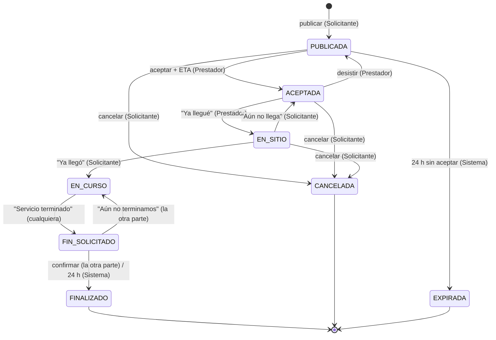

| Transición | Disparada por | Condición |
| ---------- | ------------- | --------- |
| → PUBLICADA | Solicitante | Sin otra necesidad activa (RN-04) |
| PUBLICADA → ACEPTADA | Prestador | No es el solicitante; sin otro servicio activo (RN-06); gana la primera transacción (RN-07) |
| PUBLICADA → EXPIRADA | Sistema | `expiraEn < ahora` |
| PUBLICADA / ACEPTADA / EN_SITIO → CANCELADA | Solicitante | Confirmación previa |
| ACEPTADA → PUBLICADA | Prestador | Desiste; se borran `prestadorId` y ETA; `expiraEn` no se reinicia |
| ACEPTADA → EN_SITIO | Prestador | — (aviso si está a > 200 m) |
| EN_SITIO → EN_CURSO | Solicitante | Guarda `inicioServicio` |
| EN_SITIO → ACEPTADA | Solicitante | "Aún no llega" |
| EN_CURSO → FIN_SOLICITADO | Prestador o Solicitante | Guarda `finServicio` y `finSolicitadoPor` |
| FIN_SOLICITADO → EN_CURSO | La parte que no lo pidió | Borra `finServicio` |
| FIN_SOLICITADO → FINALIZADO | La parte que no lo pidió, o el Sistema a las 24 h | Calcula los bloques (RN-09) y actualiza contadores en la misma transacción |

### 5.2 Estados de la emergencia y del vecino en emergencia

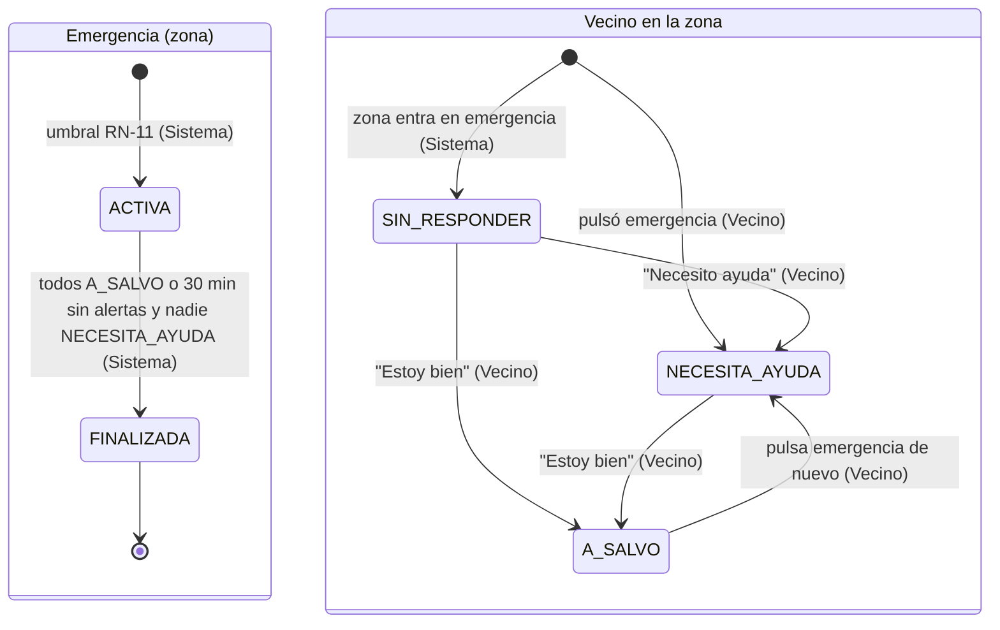

### 5.3 Etiquetas en pantalla

| Estado (BD) | Etiqueta para el solicitante | Etiqueta para el prestador |
| ----------- | ---------------------------- | -------------------------- |
| `PUBLICADA` | Esperando a un vecino | — |
| `ACEPTADA` | {nombre} va en camino | En camino |
| `EN_SITIO` | {nombre} dice que llegó | Esperando confirmación |
| `EN_CURSO` | Servicio en curso | Servicio en curso |
| `FIN_SOLICITADO` | Confirma que terminó / Esperando confirmación | Confirma que terminó / Esperando confirmación |
| `FINALIZADO` | Finalizado | Finalizado |
| `CANCELADA` | Cancelada | Cancelada por el vecino |
| `EXPIRADA` | Venció sin respuesta | — |
| `NECESITA_AYUDA` | Necesita ayuda | |
| `SIN_RESPONDER` | Sin responder | |
| `A_SALVO` | (no se muestra en el mapa) | |

### 5.4 Modelo de datos en Firestore

| Colección | Campos principales | Lee | Escribe |
| --------- | ------------------ | --- | ------- |
| `usuarios/{uid}` | `nombre`, `correo`, `telefono`, `oficios[]`, `fotoUrl`, `geohash`, `celdaH3`, `ubicacionEn`, `necesidadActivaId`, `servicioActivoId` | Dueño | Dueño (perfil y ubicación); funciones (`celdaH3`, punteros) |
| `usuarios/{uid}/dispositivos/{tokenFcm}` | `plataforma` (`android`), `creadoEn` | Dueño | Dueño |
| `usuarios/{uid}/privado/claves` | Clave SMS | Dueño, funciones | Dueño |
| `perfiles/{uid}` | `nombre`, `fotoUrl`, `oficios[]`, `horasAyudadas`, `horasSolicitadas`, `promedio`, `numCalificaciones` | Vecinos autenticados | Funciones (contadores); dueño (nombre, foto, oficios) |
| `telefonos/{e164}` | `uid` | Nadie (app) | Funciones |
| `oficios/{id}` | `nombre`, `icono`, `orden` | Todos | Consola |
| `necesidades/{id}` | `solicitanteId`, `prestadorId`, `oficioId`, `descripcion`, `geohash` (precisión 7), `estado`, `etaMinutos`, `llegadaEstimada`, `inicioServicio`, `finServicio`, `finSolicitadoPor`, `bloques`, `expiraEn`, `creadoEn` | Vecinos autenticados | Solo funciones |
| `necesidades/{id}/privado/ubicacion` | `lat`, `lng` exactos | Solicitante; prestador asignado | Funciones |
| `necesidades/{id}/privado/prestadorEnVivo` | `lat`, `lng`, `actualizadoEn` | Solicitante (en `ACEPTADA`/`EN_SITIO`) | Prestador asignado |
| `necesidades/{id}/calificaciones/{autorUid}` | `calificadoId`, `estrellas` | Participantes | Autor (solo `create`, RN-13) |
| `alertas/{id}` | `uid`, `celdaH3`, `lat`, `lng`, `canal` (`APP`/`SMS`), `emergenciaId`, `creadoEn` | Funciones | Funciones |
| `emergencias/{id}` | `celdaCentro`, `celdas[]`, `estado`, `activadaEn`, `ultimaAlertaEn`, `finalizadaEn` | Vecinos de la zona | Funciones |
| `emergencias/{id}/vecinos/{uid}` | `nombre`, `estado`, `lat`, `lng`, `ultimaAlertaEn` | Vecinos de la zona | Funciones (el vecino cambia su `estado` llamando a una función) |
| `intermediarios/{uid}` | `telefono`, `celdasCubiertas[]`, `activo`, `ultimaSenalEn` | Funciones | Funciones |
| `smsProcesados/{hash}` | `creadoEn` (anti-replay, TTL de 1 h) | Funciones | Funciones |
| `servicios/{id}` | `duenoId`, `tipo` (`OFICIO`/`SERVICIO`/`PRODUCTO`), `categoria`, `titulo`, `descripcion`, `precio`, `horario`, `fotos[]`, `geohash`, `vistosBuenos`, `activo` | Vecinos autenticados | Dueño (RF31) |
| `servicios/{id}/vistosBuenos/{uid}` | `comentario`, `creadoEn` | Vecinos autenticados | Autor (RN-17) |
| `trabajos/{id}` | `autorId`, `oficioId`, `descripcion`, `fecha`, `pago`, `geohash`, `estado` (`ABIERTO`/`CUBIERTO`/`VENCIDO`), `venceEn` | Vecinos autenticados | Autor |
| `trabajos/{id}/interesados/{uid}` | `creadoEn` | Autor del trabajo, el interesado | Interesado |
| `verificaciones/{uid}` | `dni`, `nombres`, `apellidos`, `estado`, `motivo`, `revisadoPor` (fotos en Storage `verificaciones/{uid}/`) | Dueño, validadores | Dueño (envío), validadores (estado) |
| `reportesVulnerabilidad/{id}` | `autorId`, `tipo`, `personas`, `nota`, `geohash`, `lat`, `lng`, `celdaH3`, `estado`, `atiendeId`, `canal` (`APP`/`SMS`) | Vecinos autenticados | Funciones |
| `recursosCriticos/{id}` | `autorId`, `modo` (`OFREZCO`/`NECESITO`), `tipo`, `cantidad`, `geohash`, `estado`, `asignadoId`, `canal` | Vecinos autenticados | Funciones |
| `directorioEmergencia/{id}` | `nombre`, `tipo`, `telefono`, `whatsapp`, `direccion`, `horario`, `geohash`, `aprobado` | Todos | Validadores; vecinos proponen con `aprobado = false` |
| `climaCache/{celdaH3r6}` | `tema`, `datos`, `actualizadoEn` | Funciones | Funciones |
| `auditoria/{id}` | `tipo`, `uid`, `refId`, `creadoEn` (sin datos sensibles) | Consola | Funciones |

`celdaH3` la calcula un trigger al cambiar la ubicación del usuario (H3 se calcula solo en el backend; la app usa geohash).
Índices compuestos previstos: `necesidades (estado, geohash)`, `usuarios (celdaH3, ubicacionEn)`, `alertas (celdaH3, creadoEn)`, `emergencias (estado, celdas array-contains)`.

## 6. Requerimientos no funcionales

| ID | Categoría | Requerimiento | Cómo se verifica |
| -- | --------- | ------------- | ---------------- |
| RNF01 | Plataforma | React Native + Expo para Android 7.0+ (API 24; supuesto: mínimo del SDK de Expo vigente), `targetSdk` el que exija el SDK; se ejecuta con *development build*, no con Expo Go | Build de EAS + prueba en 3 teléfonos reales con versiones distintas de Android (incluido uno con Android 14+) |
| RNF02 | Usabilidad | Diseño adaptable desde pantallas de 360 dp de ancho; publicar una necesidad en ≤ 3 pantallas desde P04; áreas táctiles ≥ 48×48 dp; respeta las zonas seguras (notch, barra de gestos) | Prueba de usabilidad con 3 personas |
| RNF03 | Accesibilidad | Contraste ≥ 4,5:1 para texto en los 4 temas (WCAG 2.1 AA); todos los botones con `accessibilityLabel`; compatible con TalkBack; respeta el tamaño de letra del sistema hasta 130 %; el cambio de tema no depende solo del color (icono de clima o emergencia en la barra superior) | Herramienta de contraste + prueba manual con lector de pantalla |
| RNF04 | Seguridad | Solo HTTPS/TLS (tráfico en texto plano deshabilitado); autenticación con Firebase Auth (sesión persistente, ID token de 1 h renovado por el SDK); **App Check** instalado pero en modo **monitoreo, sin bloquear** (Play Integrity no reconoce un APK instalado fuera de Google Play; se exige al publicar en Play); por eso la protección principal son las reglas; reglas de Firestore y Storage que niegan todo por defecto; los cambios de estado solo por funciones; secretos en Secret Manager y claves locales en `expo-secure-store` (Android Keystore), nunca en el código; la clave de Google Maps restringida al paquete y a la huella SHA-1 de la app | Pruebas de reglas con el emulador + revisión de `firestore.rules` y de la configuración nativa |
| RNF05 | Privacidad | Cumplir la Ley 29733 de protección de datos personales (Perú) (supuesto: el despliegue es en Perú): consentimiento explícito de ubicación y de SMS con una pantalla previa a cada permiso, ubicación en segundo plano solo durante un servicio activo, ubicación exacta solo según RN-14, ubicaciones en vivo y alertas de más de 7 días se borran (TTL de Firestore); los logs no contienen tokens, ubicaciones exactas ni el contenido de los SMS; la app ignora los SMS sin prefijo `VEC1:`; política de privacidad publicada en Hosting y enlazada desde P02 | Revisión de código + muestra de Cloud Logging |
| RNF06 | Rendimiento | P04 se muestra en < 2 s (p95) en 4G con 1 000 necesidades activas en la ciudad; cambios de estado visibles en el otro dispositivo en ≤ 5 s (p95); activación de emergencia en ≤ 10 s (p95); arranque en frío ≤ 3 s en un Android de gama media | Prueba de carga con datos sintéticos + medición en dispositivo |
| RNF07 | Segundo plano | La ubicación del prestador se envía en segundo plano solo entre `ACEPTADA` y `EN_SITIO`, cada 10 s o 50 m, con notificación persistente en Android; consumo de batería ≤ 5 % por hora de seguimiento (supuesto). Las alertas de emergencia llegan y abren P12 con la app cerrada y el teléfono bloqueado (push de datos de alta prioridad + full-screen intent); la app pide excluirla de la optimización de batería para no perder alertas en fabricantes agresivos (Xiaomi, Huawei, Samsung) | Prueba manual documentada en 3 marcas distintas |
| RNF08 | Concurrencia | RN-04, RN-06 y RN-07 se cumplen con 50 llamadas simultáneas sobre la misma necesidad o usuario (un solo ganador) | Prueba automatizada contra el emulador de Firebase |
| RNF09 | Disponibilidad | Persistencia offline de Firestore activada (por defecto en React Native Firebase); sin internet la app abre, muestra los datos en caché y el aviso «Sin conexión»; si Open-Meteo falla, se mantiene el último tema; si el push falla, el estado se actualiza por el listener al abrir la app | Prueba en modo avión |
| RNF10 | Escalabilidad | El conteo de emergencia consulta solo las alertas de la celda en los últimos 10 min (índice `celdaH3, creadoEn`) y un `count()` de usuarios activos de la celda, sin recorrer todos los usuarios | Revisión de consultas e índices |
| RNF11 | Mantenibilidad | TypeScript estricto en la app y las funciones; pruebas de las transiciones de estado (sección 5.1), RN-09, RN-11 y de las reglas de seguridad, con cobertura ≥ 70 % en `functions/` | Reporte de cobertura en CI |
| RNF12 | Contingencia SMS | Payload ≤ 160 caracteres GSM-7; cifrado AES-GCM-128 con nonce único; mensajes de más de 30 min o repetidos se rechazan; un SMS recibido se convierte en notificación en ≤ 5 s con la app cerrada | Pruebas unitarias del codec + prueba con 2 teléfonos en modo avión con SMS activo y 1 intermediario |
| RNF13 | Auditoría | Se registran en `auditoria`: cambios de estado de necesidades, alertas de emergencia, activación y fin de emergencias, mensajes SMS procesados (sin contenido). Los inicios de sesión los registra Firebase Auth; los cierres inesperados, Crashlytics | Revisión de la colección y de la consola |
| RNF14 | Despliegue | Backend en Firebase (Functions, reglas, índices, Hosting) desplegado desde CI; Hosting con dominio propio y TLS automático sirve `/.well-known/assetlinks.json`, la página `/s`, la página de descarga del APK y la política de privacidad; la app se compila con EAS Build como APK de distribución interna | Revisión de la configuración + prueba de App Links (`adb shell pm get-app-links`) |
| RNF15 | Entornos | Dos proyectos de Firebase (`dev` y `prod`) con su propio `google-services.json`, elegidos por el perfil de EAS (`development`, `preview`, `production`); desarrollo local contra Firebase Emulator Suite | Revisión de `eas.json` y `app.config.ts` |
| RNF16 | Costos | El MVP funciona dentro de la cuota gratuita del plan Blaze con ≤ 200 usuarios; alerta de presupuesto en Google Cloud a USD 10/mes (supuesto). EAS en plan gratuito (límite de builds mensuales) | Alerta de presupuesto configurada |
| RNF17 | Actualizaciones | Los cambios solo de JavaScript se publican con EAS Update en el canal del perfil; los cambios nativos requieren un nuevo build. La app verifica actualizaciones al abrirse | Prueba de una actualización OTA en `preview` |

## 7. Pantallas

| ID | Pantalla | Actor | RF |
| -- | -------- | ----- | -- |
| P01 | Inicio de sesión (clave, Google, Facebook, enlace mágico) | Vecino | RF02, RF03, RF04, RF07 |
| P02 | Registro | Vecino | RF01, RF02, RF03 |
| P03 | Completar perfil: oficios, foto, permisos | Vecino | RF05, RF06, RF08 |
| P04 | Principal: necesidades cercanas + «Publicar necesidad» | Vecino | RF09, RF20, RF29 |
| P05 | Publicar necesidad (oficio → descripción → ubicación) | Solicitante | RF10 |
| P06 | Detalle de necesidad + aceptar | Vecino | RF11, RF12 |
| P07 | Servicio — vista del prestador (mapa, ETA, «Ya llegué», terminar, desistir) | Prestador | RF12, RF14, RF16, RF18 |
| P08 | Servicio — vista del solicitante (prestador en el mapa, «Ya llegó», terminar, cancelar) | Solicitante | RF13, RF15, RF16, RF18 |
| P09 | Calificación | Ambos | RF17 |
| P10 | Perfil (oficios, foto, horas, calificación, historial, activar modo intermediario) | Vecino | RF05, RF06, RF17, RF27 |
| P11 | Mapa de emergencia | Vecino | RF22, RF24, RF25 |
| P12 | Alerta a pantalla completa «Estoy bien» / «Necesito ayuda» | Vecino | RF23, RF24 |
| P13 | Modo sin conexión (enviar por SMS / mensaje recibido / bandeja de salida) | Vecino | RF26, RF28, RF41 |
| P14 | Publicar en el directorio (3 pasos) | Vecino | RF31, RF42 |
| P15 | Directorio: lista, mapa, búsqueda y filtros | Vecino | RF32 |
| P16 | Ficha del directorio (contactar, Visto Bueno) | Vecino | RF32, RF33 |
| P17 | Bolsa de trabajos: lista y detalle («Me interesa») | Vecino | RF34 |
| P18 | Publicar trabajo (3 pasos) e interesados | Vecino | RF34 |
| P19 | Verificar identidad | Vecino, Validador | RF36 |
| P20 | Tutorial y guía de ayuda | Vecino | RF37 |
| P21 | Reportar vulnerabilidad | Vecino | RF38, RF42 |
| P22 | Tablero humanitario (vulnerabilidad + recursos críticos) | Vecino | RF39 |
| P23 | Directorio de emergencia y grupos de apoyo | Vecino | RF40 |

Navegación principal (pestañas inferiores): **Muro** (P04) · **Directorio** (P15) · **Trabajos** (P17) · **Emergencia** (P22/P11) · **Perfil** (P10). El botón de emergencia flota sobre todas.

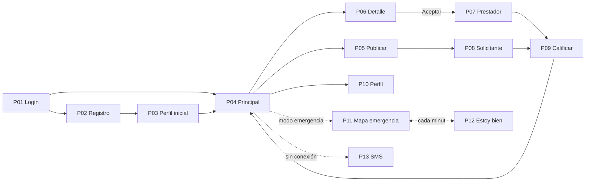

## 8. Temas visuales y paletas

Los temas se definen como objetos de tokens en TypeScript (`temas.ts`) y se aplican con un proveedor de tema (`ThemeProvider` + hook `useTema()`); cambiar de tema no reinicia la app. Prioridad: **emergencia > calor > lluvia > normal** (RF29). Con cada tema se ajustan la barra de estado (`expo-status-bar`) y la barra de navegación (`expo-navigation-bar`).

La identidad visual es **naranja dominante** (acción, rescate, energía y cercanía) con **neutros cálidos** para alta accesibilidad.

| Token | Normal (naranja de marca) | Lluvia (azul noche) | Calor (terracota) | Emergencia (rojo) |
| ----- | ------------------------- | ------------------- | ----------------- | ----------------- |
| `fondo` | `#FAFAF9` | `#0F1B2D` | `#FDF0E6` | `#FFF1F1` |
| `superficie` | `#FFFFFF` | `#172A45` | `#FFFFFF` | `#FFFFFF` |
| `primario` | `#C2410C` | `#4F8DF5` | `#9C3D1B` | `#C62828` |
| `primarioOscuro` | `#9A3412` | `#2C5BB8` | `#6F2A12` | `#8E1B1B` |
| `sobrePrimario` | `#FFFFFF` | `#0F1B2D` | `#FFFFFF` | `#FFFFFF` |
| `acento` | `#FB923C` | `#7FD1F7` | `#F59E0B` | `#FFD54F` |
| `texto` | `#1C1917` | `#E6EEF8` | `#2A140A` | `#2B0B0B` |
| `textoSecundario` | `#57534E` | `#9FB3CC` | `#6B3A22` | `#6B2B2B` |
| `borde` | `#E7E5E4` | `#2A3F5F` | `#F1CFB5` | `#F3C1C1` |
| `alertaFondo` (P12) | — | — | — | `#B71C1C` con texto `#FFFFFF` |
| Barra de estado | oscura | clara | oscura | oscura (clara en P12) |
| Icono en la barra superior | — | 🌧 lluvia | 🌡 calor | ⚠ emergencia |

El naranja `#C2410C` se usa para botones y texto sobre blanco (contraste 5,2:1); el naranja claro `#FB923C` solo para fondos, iconos e ilustraciones, nunca para texto. El botón flotante de emergencia usa `#C62828` en todos los temas (se distingue del naranja por forma e icono ⚠), salvo en lluvia, que usa `#FF5A5F` para mantener el contraste sobre el fondo oscuro. El estilo del mapa (`customMapStyle`) pasa a oscuro con el tema de lluvia. Los contrastes se validan según RNF03 antes de la entrega.

## 9. Stack tecnológico

### 9.1 App móvil

| Capa | Tecnología | Uso |
| ---- | ---------- | --- |
| Lenguaje | **TypeScript** (modo estricto) | App y funciones |
| Framework | **React Native + Expo** (SDK vigente, nueva arquitectura) | App Android (el mismo código permitiría iOS después) |
| Build y distribución | **EAS Build** (APK interno), **EAS Update**, *development build* (`expo-dev-client`) | Builds nativos y actualizaciones OTA |
| Navegación | **Expo Router** | Pantallas P01–P13 y enlaces profundos (enlace mágico, `/s#…`) |
| Firebase | **React Native Firebase** (`@react-native-firebase/app`, `auth`, `firestore`, `functions`, `storage`, `messaging`, `app-check`, `crashlytics`) con sus *config plugins* de Expo | SDK nativo: persistencia offline, push, App Check |
| Inicio de sesión | `@react-native-google-signin/google-signin`, `react-native-fbsdk-next` (Fase 2) | RF02, RF03 |
| Notificaciones | **Notifee** (`@notifee/react-native`): canales de Android, *full-screen intent*, acciones «Estoy bien» / «Necesito ayuda», notificaciones locales; FCM (`@react-native-firebase/messaging`) como transporte con manejador en segundo plano | RF13, RF23, RF24, RF28 |
| Ubicación | **expo-location** + **expo-task-manager** | Ubicación actual y en segundo plano (RF08, RF13) |
| Mapas | **react-native-maps** con Google Maps SDK for Android | P07, P08, P11 |
| Geo | **geofire-common** (geohash) | Feed por cercanía (RF09). H3 solo en el backend |
| Estado | **Zustand** (estado de UI y tema) + listeners de Firestore (datos) | Sin capa de caché extra: Firestore ya sincroniza |
| Formularios | **React Hook Form** + **Zod** | Validación de RF01 y RF10; los mismos esquemas Zod se reutilizan en las funciones |
| Estilos | `StyleSheet` + tokens de tema (sección 8) | Los 4 temas |
| Imágenes | **expo-image-picker**, **expo-image-manipulator**, **expo-image** | RF06 |
| Conectividad | **@react-native-community/netinfo** | Detección de sin conexión (RF26) |
| SMS | Módulo nativo propio **`sms-nativo`** (Expo Modules API, Kotlin): envío con `SmsManager` y recepción con un `BroadcastReceiver` de `SMS_RECEIVED` que lanza una tarea *headless* de JS; **expo-sms** como respaldo (compositor) | RF26–RF28 |
| Cifrado | **@noble/ciphers** (AES-GCM) + **expo-crypto** (bytes aleatorios) + **expo-secure-store** (clave) | RN-16 |
| Otros | **expo-haptics**, **expo-status-bar**, **expo-navigation-bar**, **expo-linking**, **date-fns** (locale `es`) | Botón de emergencia, temas, enlaces, fechas |

### 9.2 Backend (Firebase)

| Servicio | Uso | RF |
| -------- | --- | -- |
| **Firebase Auth** | Correo/clave, Google, Facebook (Fase 2), enlace de correo, recuperación de clave | RF01–RF04, RF07 |
| **Cloud Firestore** | Base de datos, tiempo real (listeners), persistencia offline, transacciones, TTL | Todos |
| **Cloud Functions (2.ª gen., Node 20, TypeScript)** | Funciones invocables para cambios de estado, triggers de Firestore, tareas programadas, webhook HTTPS. Usa `h3-js` para las celdas | RF10–RF29 |
| **Cloud Scheduler** (vía `onSchedule`) | Función `cadaMinuto`: expiraciones, retrasos, alertas de emergencia, cierres | RF19, RF23, RF25, RN-10 |
| **Cloud Storage** | Fotos de perfil | RF06 |
| **Firebase Cloud Messaging** | Push (mensajes de datos de prioridad alta para emergencias) | RF10, RF13, RF19, RF21, RF23 |
| **Firebase Hosting** | Dominio de App Links, página `/s`, página de descarga del APK, política de privacidad | RF04, RF28, RNF14 |
| **App Check** | Play Integrity en modo monitoreo (no se exige con APK interno); proveedor de depuración en desarrollo | RNF04 |
| **Crashlytics** | Reporte de cierres inesperados | RNF13 |
| **Secret Manager** | Código de activación del modo intermediario y secreto del webhook externo opcional | RF27 |
| **Región** | `southamerica-east1` (São Paulo) para Firestore y Functions (supuesto: la más cercana a Perú) | RNF06 |

### 9.3 Externos

| Servicio | Uso |
| -------- | --- |
| **Open-Meteo** | Clima actual e histórico de 30 días, sin clave (RF29) |
| **Google Maps SDK for Android** | Mapa (requiere clave de API restringida a la app) |
| **Operador móvil** | SMS entre los vecinos y el móvil intermediario (plan con SMS en el chip del intermediario) |

### 9.4 Calidad y entrega

| Área | Herramienta |
| ---- | ----------- |
| Lint y formato | ESLint (`eslint-config-expo`) + Prettier |
| Pruebas unitarias | Jest (`jest-expo`) + React Native Testing Library |
| Pruebas de reglas y funciones | Firebase Emulator Suite + `@firebase/rules-unit-testing` |
| Pruebas E2E | Maestro (flujos en YAML sobre el *development build*) |
| CI/CD | GitHub Actions: lint + pruebas en cada PR; `firebase deploy` del backend al hacer merge a `main`; EAS Build/Update disparados desde CI (`eas build --platform android --profile preview`, `eas update --channel preview`) |
| Monitoreo | Crashlytics (app), Cloud Logging (funciones) |

### 9.5 Estructura del repositorio

Monorepo con 4 paquetes. Dentro de la app se organiza **por módulos de negocio** (estilo DDD liviano, tomando como referencia la organización por *features*). Cada módulo es dueño de sus pantallas, su lógica, su acceso a datos y sus mensajes SMS. Los nombres van en español, salvo las carpetas cuyo nombre exige una herramienta (`app/` de Expo Router, `modules/` de los módulos nativos de Expo, `functions/` de Firebase).

```text
/
├── movil/                          # App Expo (React Native)
│   ├── src/
│   │   ├── app/                    # RUTAS de Expo Router: archivos delgados que solo importan pantallas
│   │   │   ├── _layout.tsx         # proveedores: tema, sesión, bandeja de salida, notificaciones
│   │   │   ├── (publico)/          # sin sesión
│   │   │   │   ├── bienvenida.tsx          → bienvenida (P20)
│   │   │   │   ├── ingresar.tsx            → cuentas (P01)
│   │   │   │   └── registro.tsx            → cuentas (P02)
│   │   │   ├── (privado)/          # con sesión
│   │   │   │   ├── completar-perfil.tsx    → cuentas (P03)
│   │   │   │   ├── verificar-identidad.tsx → identidad (P19)
│   │   │   │   ├── (pestanas)/
│   │   │   │   │   ├── _layout.tsx         # pestañas + botón de emergencia flotante
│   │   │   │   │   ├── favores/            → favores (P04–P09)
│   │   │   │   │   ├── directorio/         → directorio (P14–P16)
│   │   │   │   │   ├── trabajos/           → trabajos (P17–P18)
│   │   │   │   │   ├── emergencia/         → ayuda-humanitaria (P11, P21–P23)
│   │   │   │   │   └── perfil/             → cuentas (P10), contingencia-sms (modo intermediario)
│   │   │   │   └── alerta.tsx              → emergencia (P12, modal a pantalla completa)
│   │   │   └── s.tsx               # App Link de los SMS → contingencia-sms (P13)
│   │   │
│   │   ├── modulos/                # MÓDULOS DE NEGOCIO (uno por funcionalidad)
│   │   │   ├── cuentas/            # registro, ingreso, perfil, oficios
│   │   │   ├── identidad/          # verificación con DNI y selfie
│   │   │   ├── bienvenida/         # tutorial y guía de ayuda
│   │   │   ├── directorio/         # oficios, servicios, productos, Visto Bueno Vecinal
│   │   │   ├── trabajos/           # bolsa de trabajos rápidos
│   │   │   ├── favores/            # muro solidario y ciclo del servicio
│   │   │   ├── emergencia/         # botón, activación por zona, alerta, «Estoy bien»
│   │   │   ├── ayuda-humanitaria/  # mapa de emergencia, vulnerabilidad, recursos críticos, directorio de apoyo
│   │   │   └── contingencia-sms/   # transporte SMS, receptor, modo intermediario
│   │   │
│   │   ├── nucleo/                 # INFRAESTRUCTURA sin pantallas (la usan todos los módulos)
│   │   │   ├── firebase/           # inicialización, App Check, emuladores
│   │   │   ├── sesion/             # usuario actual, perfil en memoria
│   │   │   ├── bandeja-salida/     # enviarAccion(): internet → SMS → cola (RF41)
│   │   │   ├── ubicacion/          # useUbicacionValidada(), tarea en segundo plano (RF42)
│   │   │   ├── notificaciones/     # FCM, canales de Notifee, manejador en segundo plano
│   │   │   ├── red/                # estado de conexión (NetInfo)
│   │   │   └── clima/              # obtenerClima y cálculo del tema (RF29)
│   │   │
│   │   ├── compartido/             # PIEZAS REUTILIZABLES sin lógica de negocio
│   │   │   ├── ui/                 # Boton, Tarjeta, Campo, ListaVacia, Insignia, MapaBase, AsistentePasos
│   │   │   ├── tema/               # tokens de la sección 8, ThemeProvider, useTema()
│   │   │   ├── hooks/              # useDebounce, useIntervalo…
│   │   │   ├── utilidades/         # fechas, distancias, formatos
│   │   │   └── constantes/         # catálogos (oficios, tipos de favor, tipos de vulnerabilidad)
│   │   │
│   │   ├── recursos/               # imágenes, ilustraciones del tutorial, sonidos de alerta
│   │   └── simulaciones/           # mocks para trabajar sin depender de otro módulo
│   │
│   ├── modules/
│   │   └── sms-nativo/             # módulo Expo en Kotlin (SmsManager + BroadcastReceiver)
│   ├── app.config.ts
│   └── eas.json
│
├── functions/                      # Cloud Functions (mismos nombres de módulo que la app)
│   └── src/
│       ├── index.ts                # solo exporta las funciones de cada módulo
│       ├── modulos/
│       │   ├── cuentas/ · identidad/ · directorio/ · trabajos/ · favores/
│       │   ├── emergencia/ · ayuda-humanitaria/ · contingencia-sms/ · clima/
│       ├── programadas/
│       │   └── cadaMinuto.ts       # orquesta las tareas que registra cada módulo
│       └── nucleo/                 # admin SDK, notificar(), h3, validación con Zod, auditoría
│
├── compartido/                     # Paquete npm usado por la app y las funciones
│   └── src/
│       ├── modelos/                # tipos de cada colección (sección 5.4)
│       ├── esquemas/               # esquemas Zod de entrada de cada función
│       └── sms/                    # protocolo SMS (sección 10.4): cifrado, codec y registro de tipos
│
├── hosting/public/                 # .well-known/assetlinks.json, /s, descarga del APK, privacidad
├── firestore.rules · firestore.indexes.json · storage.rules · firebase.json
└── .github/workflows/
```

#### Estructura interna de cada módulo

Todos los módulos de `movil/src/modulos/` siguen el mismo esqueleto. Si una carpeta no se necesita, no se crea.

```text
modulos/favores/
├── index.ts            # API PÚBLICA: lo único que otros módulos pueden importar
├── tipos.ts            # tipos del módulo (re-exporta los modelos de compartido/)
├── reglas.ts           # reglas de negocio puras y testeables (p. ej., calcularBloques, RN-09)
├── servicios/          # acceso a datos: consultas de Firestore y llamadas a funciones
│   ├── necesidadesRepositorio.ts
│   └── servicioApi.ts
├── hooks/              # estado de pantalla: useMuro(), useServicioEnCurso()
├── componentes/        # componentes propios: TarjetaNecesidad, SelectorEta, Cronometro
├── pantallas/          # pantallas completas: MuroPantalla, PublicarPantalla, DetallePantalla…
├── sms/                # codecs de sus tipos SMS (N, A, L, C, F, X, NV, ES) y su manejador de recepción
└── __tests__/          # pruebas de reglas.ts y de los codecs
```

En `functions/src/modulos/<modulo>/` el esqueleto equivalente es `invocables.ts` (funciones llamadas por la app), `disparadores.ts` (triggers de Firestore), `programadas.ts` (tareas que se registran en `cadaMinuto`), `sms.ts` (manejador para `procesarSms`), `reglas.ts` y `__tests__/`.

#### Reglas de dependencia

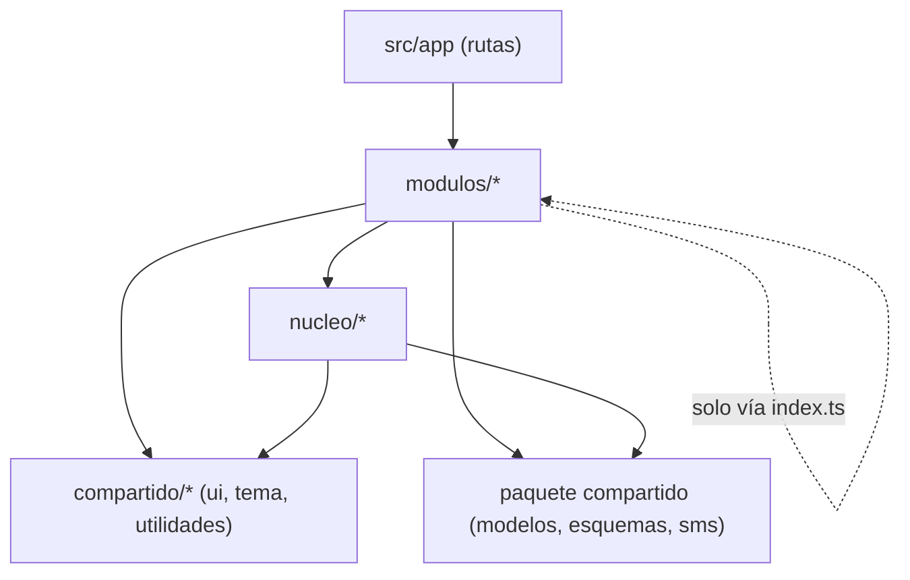

1. `src/app/` no tiene lógica: cada archivo de ruta importa una pantalla del módulo y la exporta.
2. Un módulo **no importa archivos internos de otro módulo**, solo su `index.ts` (p. ej., `emergencia` usa `TableroHumanitario` desde `ayuda-humanitaria/index.ts`). Se verifica con la regla `import/no-restricted-paths` de ESLint.
3. `nucleo/` y `compartido/` nunca importan desde `modulos/`.
4. Las pantallas no llaman a Firestore directamente: pasan por `servicios/`, y toda escritura pasa por la bandeja de salida (`nucleo/bandeja-salida`).
5. Cada módulo registra sus tipos SMS en el protocolo de `compartido/src/sms/` y su manejador en `functions/src/modulos/<modulo>/sms.ts`.

## 10. Arquitectura y despliegue

### 10.1 Diagrama de componentes

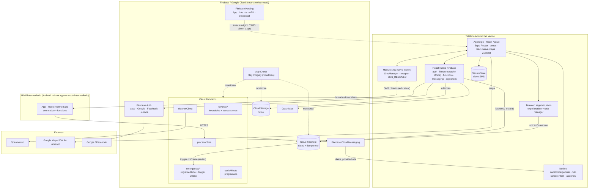

### 10.2 Responsabilidades

| Componente | Responsabilidad | RF |
| ---------- | --------------- | -- |
| App Expo | Interfaz, permisos, temas, mapas, detección de conexión, enlaces profundos | Todos |
| Tarea en segundo plano | Envío de la ubicación del prestador con la app cerrada | RF13 |
| Notifee | Canal «Emergencias», full-screen intent, acciones «Estoy bien» / «Necesito ayuda», notificaciones locales de SMS | RF23, RF24, RF28 |
| Módulo `sms-nativo` | Envío y recepción de SMS `VEC1:` en segundo plano | RF26, RF27, RF28 |
| Firebase Auth | Registro, login, proveedores de identidad, enlaces mágicos, recuperación de clave | RF01–RF04, RF07 |
| Firestore + reglas | Datos, tiempo real, control de lectura (RN-13, RN-14) | Todos |
| `favores/*` | Máquina de estados en transacciones, bloques, contadores, calificaciones | RF10–RF18 |
| `emergencia/*` | Registro de alertas, celdas H3, conteo, activación, "Estoy bien" | RF20, RF21, RF22, RF24 |
| `cadaMinuto` | Expiración, retrasos, alertas cada minuto, cierre de emergencias y servicios | RF19, RF23, RF25, RN-10 |
| `obtenerClima` | Consulta y caché del clima, cálculo del tema | RF29 |
| `procesarSms` | Descifrado, anti-replay, procesamiento del evento y cola de SMS de respuesta para el intermediario | RF26–RF28 |
| Hosting | `assetlinks.json`, página `/s`, descarga del APK, política de privacidad | RF04, RF28 |

### 10.3 Despliegue y HTTPS

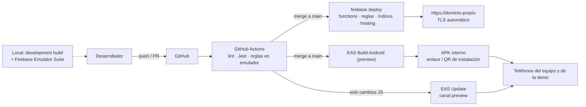

- **HTTPS en la app:** todo el tráfico va por TLS: `usesCleartextTraffic=false` y sin `network_security_config` permisivo. La única excepción es el build `development`, que permite HTTP hacia la IP local de los emuladores de Firebase.
- **HTTPS en Hosting:** Firebase Hosting emite y renueva solo el certificado TLS del dominio propio y de `*.web.app`; HTTP redirige a HTTPS; HSTS (`max-age=31536000; includeSubDomains`) y `X-Content-Type-Options: nosniff` en `firebase.json`.
- **App Links:** Hosting sirve `/.well-known/assetlinks.json` con la huella SHA-256 del certificado de firma de EAS. La app declara `intentFilters` con `autoVerify` en `app.config.ts`. Los usan el enlace mágico (RF04) y el enlace de respaldo de los SMS (RF28).
- **Perfiles de EAS:** `development` (dev client, proyecto Firebase `dev`, App Check de depuración), `preview` (APK de distribución interna, `dev`) y `production` (APK de distribución interna, proyecto `prod`). Todos con `android.buildType: "apk"` y `distribution: "internal"`. Cada perfil inyecta su `google-services.json` como secreto de EAS.
- **Instalación:** EAS entrega un enlace y un QR por build; Hosting publica una página de descarga con el último APK de producción. Las actualizaciones de solo JavaScript llegan por EAS Update sin reinstalar.
- **Credenciales:** el keystore de Android lo administra EAS; sus huellas SHA-1 y SHA-256 se registran en Firebase (Google Sign-In, App Links) y en la restricción de la clave de Google Maps. Si se pierde el keystore, los teléfonos tendrían que desinstalar e instalar de nuevo. El despliegue a Firebase desde GitHub Actions usa Workload Identity Federation (sin claves JSON en el repo).
- **Actualizaciones:** los cambios de JavaScript se publican con EAS Update en el canal del perfil; cualquier cambio de dependencias nativas, permisos o plugins requiere un build nuevo (RNF17).

### 10.4 Protocolo SMS (contrato compartido)

El SMS es el transporte de respaldo de las acciones críticas cuando no hay internet. Este protocolo es el contrato entre la app, el móvil intermediario y la función `procesarSms`; vive en `shared/sms/` y **cada dueño de funcionalidad agrega y prueba sus propios tipos de mensaje**.

**Formato del SMS:** `VEC1:` + Base64URL( nonce 12 B ‖ AES-GCM( texto ) ‖ tag 16 B ).

- Como máximo **2 segmentos** (≤ 306 caracteres GSM-7), lo que deja ~195 bytes de texto plano; los mensajes de emergencia deben caber en **1 segmento** (~88 bytes).
- Texto plano: campos separados por `|`, con este encabezado: `tipo|idMsg|ts|…campos`.
  - `idMsg`: 6 caracteres base36 aleatorios (para deduplicar y acusar recibo).
  - `ts`: segundos desde 2026-01-01 en base36.
  - Coordenadas: `lat` y `lng` con 4 decimales, multiplicadas por 10⁴ y en base36.
- Las necesidades, emergencias, reportes y recursos tienen un `codigo` corto de 6 caracteres (además del id de Firestore) para poder citarlos por SMS.
- Clave: la del vecino (RN-16). Se genera y se sube al servidor **la primera vez que hay internet**; sin ese paso el vecino no puede usar SMS (la app lo avisa en P13).

**Subida (vecino → intermediario → `procesarSms`):**

| Tipo | Acción | Campos | Dueño |
| ---- | ------ | ------ | ----- |
| `E` | Alerta de emergencia (RF20) | `lat`, `lng` | Persona D |
| `K` | «Estoy bien» / «Necesito ayuda» (RF24) | `codigoEmergencia`, `estado` (`B`/`A`) | Persona D |
| `V` | Reporte de vulnerabilidad (RF38) | `tipo`, `personas`, `lat`, `lng`, `nota` (≤ 40) | Persona E |
| `R` | Recurso crítico ofrezco/necesito (RF39) | `modo`, `tipo`, `cantidad`, `lat`, `lng` | Persona E |
| `N` | Publicar necesidad u oferta (RF10, RF35) | `tipo`, `categoria`, `lat`, `lng`, `texto` (≤ 60) | Persona C |
| `A` | Aceptar (RF12) | `codigo`, `eta` (5/10/15) | Persona C |
| `L` / `C` / `F` / `X` | Llegué / Confirmo llegada / Terminé / Cancelar (RF14–RF18) | `codigo` | Persona C |

**Bajada (`procesarSms` → intermediario → vecino):**

| Tipo | Aviso | Campos | Dueño |
| ---- | ----- | ------ | ----- |
| `OK` | Acuse de recibo | `idMsg`, `codigo` creado (si aplica) | Persona D |
| `EA` | Emergencia activada en tu zona | `codigoEmergencia`, `lat`, `lng` | Persona D |
| `AL` | ¿Estás bien? (cada minuto mientras no responda) | `codigoEmergencia` | Persona D |
| `VR` | Reporte de vulnerabilidad cercano | `codigo`, `tipo`, `personas`, `lat`, `lng` | Persona E |
| `NV` | Necesidad u oferta nueva cerca, de mis oficios | `codigo`, `tipo`, `categoria`, `distancia`, `texto` (≤ 40) | Persona C |
| `ES` | Cambio de estado de mi necesidad o servicio | `codigo`, `estado`, `nombre` (≤ 15) | Persona C |

**Reglas de transporte:**

- **Destino:** la app guarda, cuando tiene internet, la lista de intermediarios activos de su zona (`intermediarios`) y envía al más cercano.
- **Reintentos:** si no llega el `OK` en 2 min, reintenta hasta 3 veces (al mismo intermediario o al siguiente de la lista).
- **Bajada selectiva:** solo se envía por SMS a vecinos sin señal reciente (última ubicación hace más de 2 min) y, en el caso de `NV`, solo a los que ofrecen ese oficio, con un máximo de 10 destinatarios por evento (control de costo).
- **Recepción en el teléfono del vecino:** el receptor nativo descifra el SMS, actualiza la caché local y muestra una notificación. Los tipos `EA` y `AL` usan el canal «Emergencias» con pantalla completa.
- **Datos de prueba:** cada tipo tiene en `shared/sms/__tests__` un vector con el texto plano, el SMS cifrado y su largo, y la prueba falla si supera su presupuesto de segmentos.

## 11. Diagramas de secuencia

### 11.1 Registro e inicio de sesión con enlace mágico

Cubre: RF01, RF04, RF05, RF08 · RN-01, RN-02 · RNF04

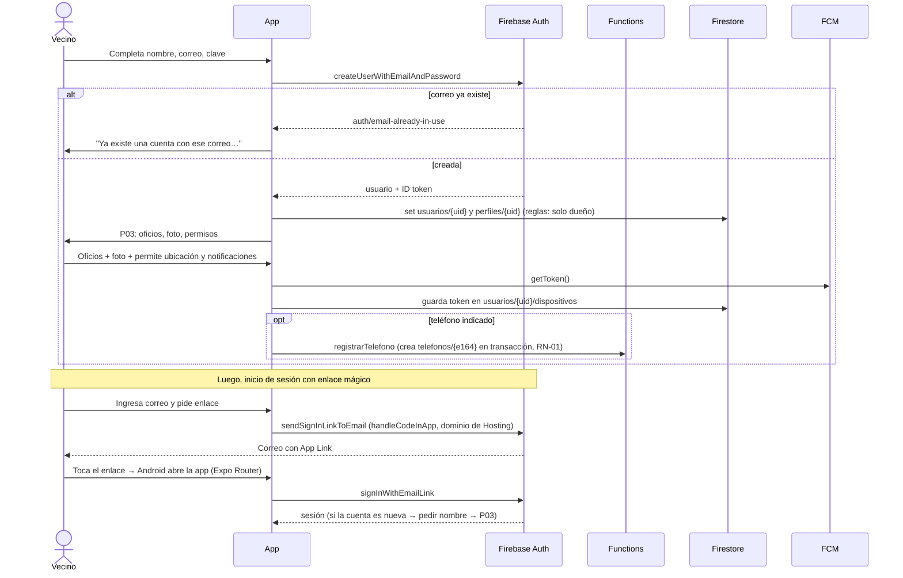

### 11.2 Publicar una necesidad y verla en el feed

Cubre: RF09, RF10 · RN-03, RN-04, RN-05 · RNF06

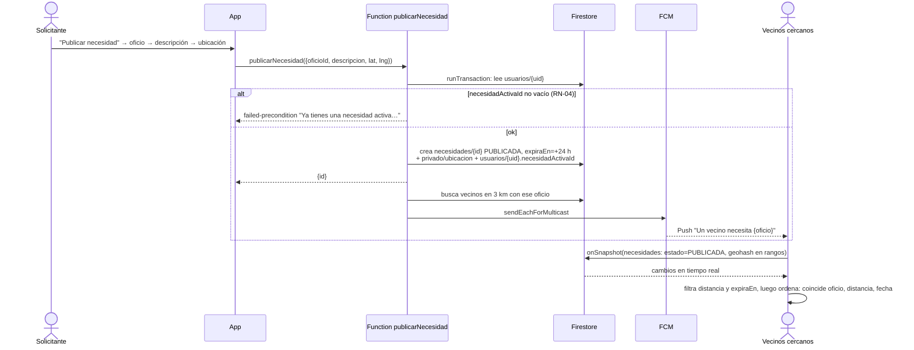

### 11.3 Aceptar una necesidad y elegir el tiempo de llegada

Cubre: RF11, RF12, RF13 · RN-06, RN-07, RN-14 · RNF06, RNF07, RNF08

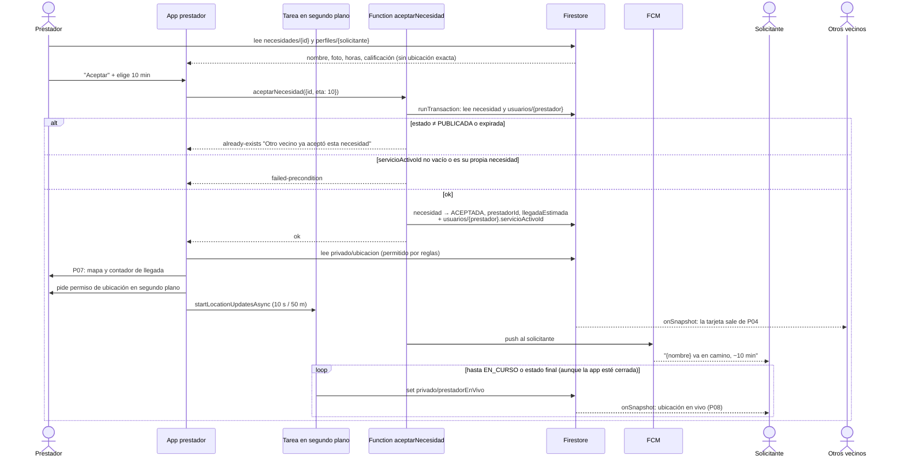

### 11.4 Llegada, servicio, cierre y calificación

Cubre: RF14, RF15, RF16, RF17 · RN-09, RN-10, RN-13, RN-15

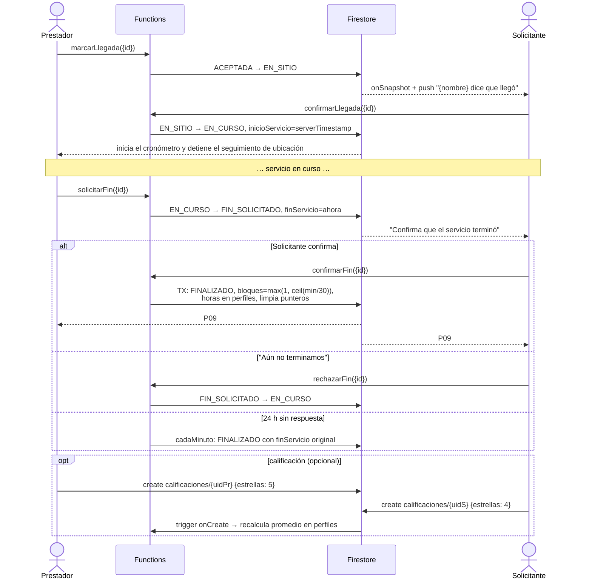

### 11.5 Activación del modo emergencia

Cubre: RF20, RF21, RF22 · RN-11, RN-12 · RNF06, RNF10

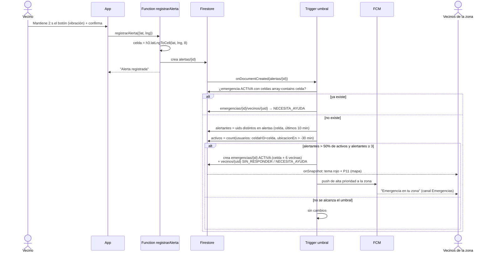

### 11.6 Alerta cada minuto y "Estoy bien"

Cubre: RF23, RF24, RF25 · RNF07

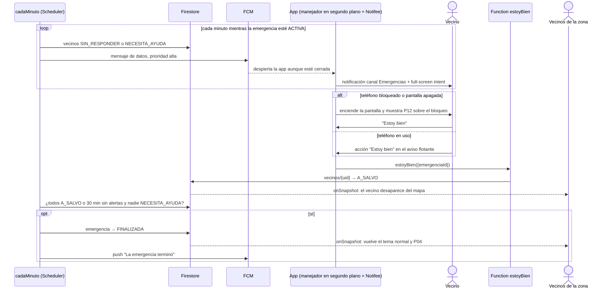

### 11.7 Contingencia por SMS

Cubre: RF26, RF27, RF28 · RN-16 · RNF12

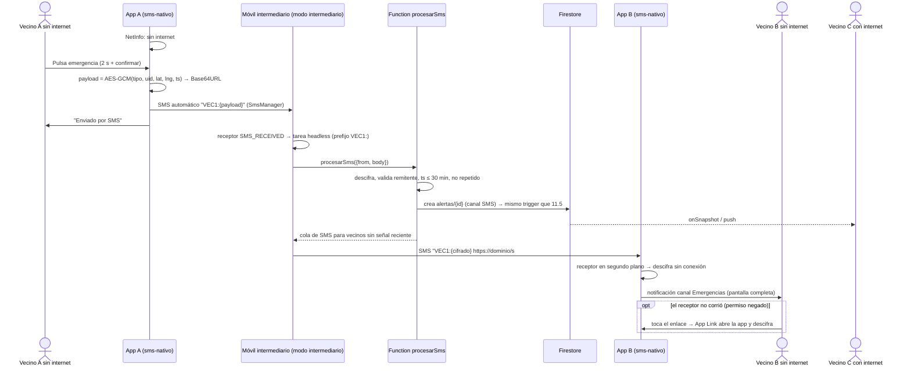

### 11.8 Cambio de tema por clima

Cubre: RF29 · RNF03, RNF09

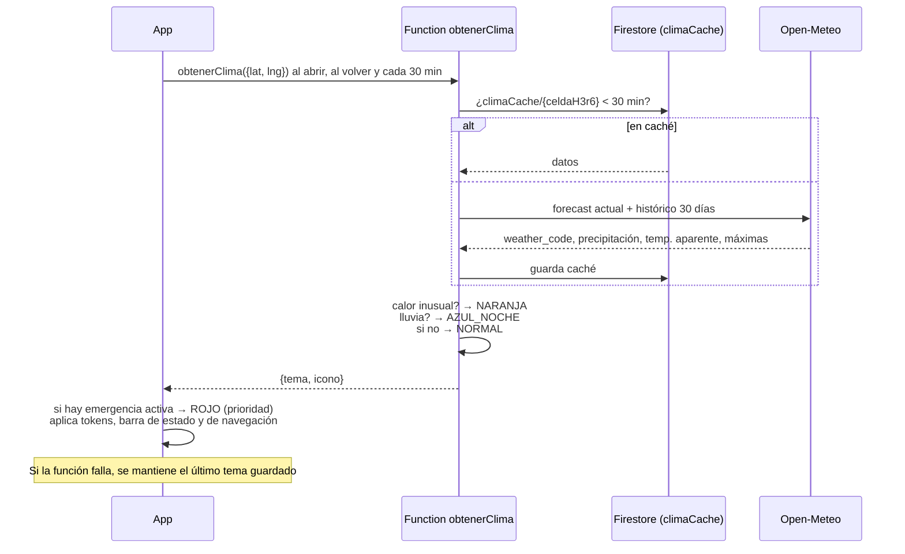

## 12. Decisiones y preguntas abiertas

### 12.1 Decisiones

| Fecha | Pregunta | Decisión | Motivo |
| ----- | -------- | -------- | ------ |
| 2026-11-07 | Plataforma y stack | App móvil con React Native + Expo y Firebase (reemplaza la PWA de la versión 0.2) | Acceso a ubicación en segundo plano, notificaciones confiables y SMS |
| 2026-11-07 | ¿Android, iOS o ambos? | Solo Android en la hackatón; iOS fuera del alcance (el código Expo permite sumarlo después) | El equipo no tiene cuenta de Apple Developer |
| 2026-11-07 | Distribución | APK de distribución interna de EAS (sin Google Play) | Demo con builds internos; sin cuentas de tienda ni revisión |
| 2026-11-07 | App Check | Instalado en modo monitoreo, sin bloquear | Play Integrity no reconoce APKs instalados fuera de Play; la seguridad descansa en las reglas y en validar todo en las funciones |
| 2026-11-07 | Alerta de emergencia a pantalla completa | Full-screen intent con Notifee, como en la idea original | Fuera de Google Play no aplica la restricción de ese permiso |
| 2026-11-07 | SMS (idea 12) | Envío y recepción automáticos con un módulo nativo propio (`SEND_SMS`/`RECEIVE_SMS`); el móvil intermediario es la misma app en modo intermediario; el enlace queda como respaldo | Fuera de Google Play no aplica la restricción de permisos de SMS; se acerca a la idea original |
| 2026-11-07 | SDK de Firebase | React Native Firebase con *development build* de EAS (no Expo Go, no SDK web) | Push nativo, App Check nativo y persistencia offline |
| 2026-11-07 | ¿Las horas son un banco de tiempo con saldo? | No: solo reputación (RN-08) | Modelo más simple; no bloquea a quien más necesita ayuda |
| 2026-11-07 | ¿Cómo se define el radio de 1 km de la emergencia? | Celdas H3 fijas de resolución 8 + vecinas (RN-11), calculadas solo en Cloud Functions | Cálculo determinista e indexable; evita cargar H3 (WebAssembly) en la app |
| 2026-11-07 | Alcance | Se documenta todo; cada RF lleva fase MVP o Fase 2 | Visión completa sin comprometer la demo |
| 2026-11-07 | Ubicación del prestador | En segundo plano solo entre `ACEPTADA` y `EN_SITIO`; el permiso se pide al aceptar el primer servicio | Las tiendas exigen justificar la ubicación en segundo plano en el momento de uso |
| 2026-11-07 | Base de datos | Firestore; geohash para cercanía y H3 para zonas | Viene con Firebase; los listeners dan tiempo real |
| 2026-11-07 | Unicidad de necesidad/servicio activo | Punteros en `usuarios/{uid}` escritos solo por funciones en transacción | Firestore no tiene índices únicos parciales |
| 2026-11-07 | Login "con nombre/correo y clave" | Correo + clave; teléfono solo como dato del perfil; login por teléfono en Fase 2 | Firebase Auth no soporta teléfono + clave; el nombre no es único |
| 2026-11-07 | Bloqueo tras 5 intentos y vencimiento del enlace en 15 min | Se usan los límites de Firebase Auth + App Check | No son configurables sin un backend propio |
| 2026-11-07 | Iniciar sesión con Apple | RF30 queda para el futuro, solo si se lanza iOS | Norma 4.8 de App Store; no aplica mientras sea solo Android |
| 2026-11-07 | Ruta en el mapa | Dos puntos + «Abrir en Google Maps» | Evita un API de rutas de pago |
| 2026-11-07 | Facebook | Fase 2 | Su revisión de app puede demorar más que la hackatón |
| 2026-11-07 | Alcance del reto (48 h) | Se agregan directorio con Visto Bueno, bolsa de trabajos, muro de ofertas, identidad, onboarding, tablero humanitario, directorio de emergencia y modo offline (RF31–RF42) | Características esperadas del reto |
| 2026-11-07 | Paleta | Normal = naranja de marca con neutros; calor = terracota; lluvia = azul noche; emergencia = rojo | La identidad visual pide naranja dominante |
| 2026-11-07 | Validación de identidad | Selfie + foto del DNI + DNI + nombres; revisión manual por un validador; sin API externa | Viable en 48 h |
| 2026-11-07 | Donaciones con Yape/Plin | Fuera del alcance; solo donaciones materiales en el muro | No hay API pública para cobros entre personas |
| 2026-11-07 | Grupos de apoyo | Fichas del directorio de emergencia con enlace a WhatsApp; sin chat propio | Un chat moderado no cabe en 48 h |
| 2026-11-07 | SMS | Pasa de Fase 2 a **MVP**; teléfono obligatorio en el registro (cierra la pregunta 6) | El SMS es la base del modo offline |

### 12.2 Preguntas abiertas

| # | Pregunta | Afecta a | Responsable |
| - | -------- | -------- | ----------- |
| 1 | ¿Se acepta el mínimo de 3 alertantes además del 50 % para activar la emergencia? Sin él, 1 de 2 vecinos activa toda la zona. | RN-11 | Equipo |
| 2 | ¿Cuándo termina una emergencia? Propuesta: todos a salvo, o 30 min sin alertas y nadie pidiendo ayuda. | RF25 | Equipo |
| 3 | ¿Radio del feed de necesidades? Propuesta: 3 km. | RF09 | Equipo |
| 4 | ¿Umbral de "calor inusual"? Propuesta: aparente ≥ 30 °C o ≥ media de 30 días + 5 °C. ¿Es para Lima u otra ciudad? | RF29 | Equipo |
| 5 | ¿Se necesita chat o llamada entre solicitante y prestador? Hoy está fuera del alcance. | Alcance | Equipo |
| 6 | ~~¿Teléfono en el registro o al activar la contingencia?~~ Resuelta: obligatorio en el registro. | RF01, RF26 | — |
| 7 | ¿Se bloquea publicar necesidades durante el modo emergencia o se permite pedir ayuda específica (p. ej., primeros auxilios)? | RF22 | Equipo |
| 8 | ¿Quién opera el móvil intermediario, con qué chip y qué plan de SMS? ¿Uno por zona o uno para toda la demo? ¿Cómo se activa el modo intermediario (código de administrador)? | RF26–RF28 | Equipo |
| 9 | ¿Qué dominio propio se usará para Hosting y los App Links? ¿Quién tiene acceso al DNS? (Sin dominio propio se puede usar `*.web.app`.) | RF04, RF28, RNF14 | Equipo |
| 10 | ¿Se confirma la región `southamerica-east1`? (La región de Firestore no se puede cambiar después de crearla.) | RNF06 | Equipo |
| 11 | ¿Qué teléfonos Android habrá en la demo (marcas y versiones)? Afecta las pruebas de full-screen intent y de optimización de batería (RNF07). | RNF01, RNF07 | Equipo |
