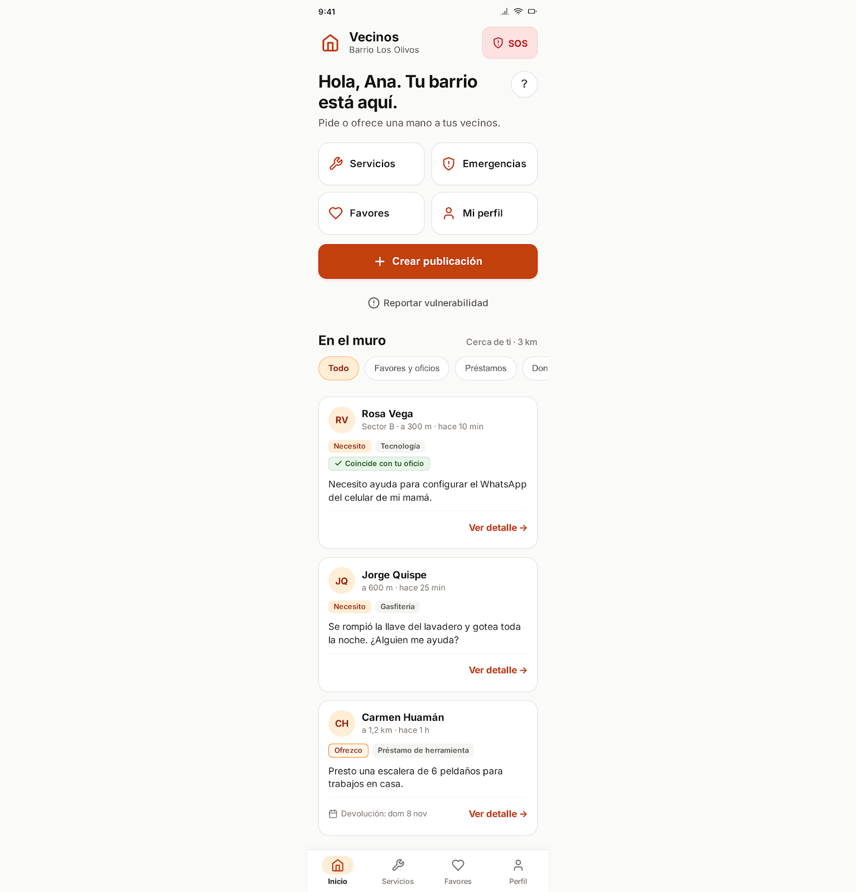
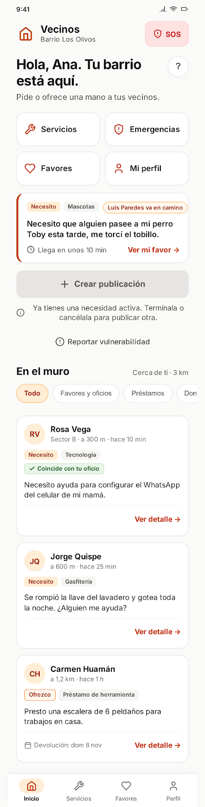
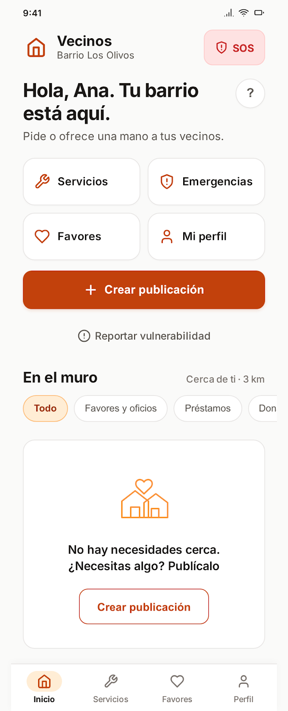
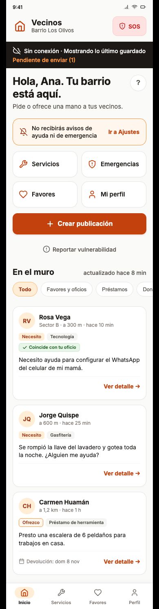
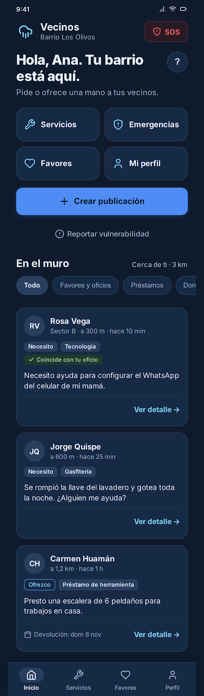

# P04 — Inicio (muro cercano)

| Módulo | Dueño | RF | Frame de referencia |
| --- | --- | --- | --- |
| `modulos/favores` | Persona C | RF09, RF20, RF29, RF35, RF37, RF38 | Aprobado el 2026-11-07: `v1.1.png` (04-A), `v1.2.png` (04-B), `v1.3.png` (04-C), `v2.1.png` (04-D), `v2.2.png` (04-E) |

| 04-A Inicio | 04-B Publicación activa | 04-C Vacío | 04-D Sin conexión | 04-E Lluvia |
| --- | --- | --- | --- | --- |
|  |  |  |  |  |

## Contenido

Pantalla principal con sesión. Saluda al vecino, ofrece los cuatro accesos rápidos (Servicios, Emergencias, Favores, Mi perfil) y el botón «Crear publicación», y lista el muro: necesidades y ofertas cercanas (radio de 3 km), primero las que coinciden con los oficios del vecino, sin incluir las propias. Desde aquí también se abre la guía de ayuda («?», RF37) y «Reportar vulnerabilidad» (RF38).

## Estados y variantes

- **Necesidad activa propia (RN-04):** tarjeta «Tu publicación» con la etiqueta de la sección 5.3 y «Crear publicación» deshabilitado con el motivo.
- **Vacío (RF09):** «No hay necesidades cerca. ¿Necesitas algo? Publícalo».
- **Sin conexión (RNF09, RF41):** franja «Sin conexión», muro desde la caché y «Pendiente de enviar ({n})».
- **Notificaciones rechazadas (RF08):** aviso permanente «No recibirás avisos de ayuda ni de emergencia» con botón a Ajustes.
- **Tema lluvia** (oscuro) para revisar contraste. **Tema emergencia: no aplica**, porque P04 se reemplaza por P11 (RF22).

## Ajustes respecto al diseño

Manda el README raíz. De [muro.png](muro.png) solo se toman las posiciones (sección 7).

- Nombre «Vecinos», no «Entrevecinos».
- Texto blanco sobre el botón naranja (RNF03); en muro.png es oscuro.
- Las tarjetas son necesidades y ofertas (RF09, RF35), no posts de «Encuentro vecinal» o «Vida de barrio»; sin fotos grandes ni «comentarios» (no hay chat, sección 3.2).
- Ajustes a resolver en la implementación: ver «Decisión» en [prompt.md](prompt.md) (ancho por dispositivo, pie de la tarjeta, icono de Favores, chip de estado en su línea, vacío sin botón duplicado, icono del tema junto al nombre, tokens de éxito para el tema lluvia).
